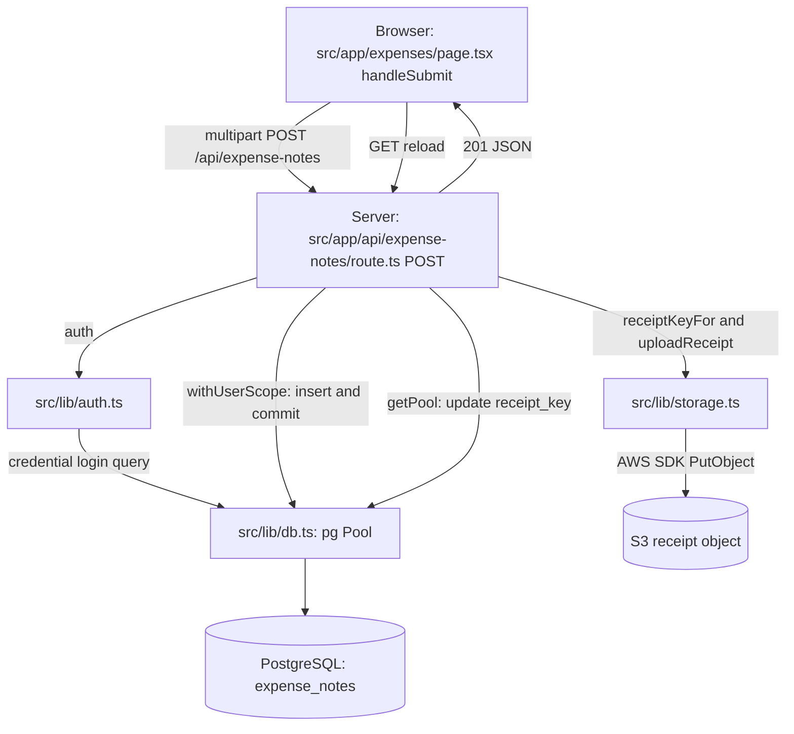

# Existing actors and submission — source inspection

Source SHA: `265924bc7274047989e708ab635c2854d376230f`. OBSERVATION from code, not runtime verification. Arrows below mean request/call dependency; they do not assert a distributed application.

## Actual actor and permission map

| Actor | Source-visible actions | Concrete files | Validation limit |
| --- | --- | --- | --- |
| Visitor | Signup/login; signup makes first account on email domain RH, later accounts employees | `src/app/actions/auth.ts`; `src/lib/auth.ts` | Not executed; no manager role from signup |
| Any authenticated user | Submit own note, list own notes, get own receipt link, request OCR | `src/app/expenses/page.tsx`; `src/app/api/expense-notes/**` | POST has no employee-only role guard |
| Manager | List pending notes of direct reports; approve/reject them | `src/components/PendingApprovalsPanel.tsx`; `src/app/api/manager/expense-notes/**` | Runtime tenant/RLS controls unverified |
| Manager viewing receipt | Route checks role then queries note by ID | `src/app/api/manager/expense-notes/[id]/receipt-url/route.ts` | Route has no report/company predicate; investigate separately |
| RH | Company directory and manager assignment; pending root-manager notes, decisions and receipts in own company | `src/components/AdminConsole.tsx`; `src/app/api/hr/**` | Assignment checks target company but selected manager lookup lacks company predicate |

Company is a data grouping, not a login role. PostgreSQL, S3 and OCR are supporting systems. No finance actor, billing flow, OpenAI integration or queue was identified in the inspected source. This does not describe mandatory future scope.

## Lesson 1: submit one receipt-backed note

Example: signed-in user enters €12.50, a date and description, attaches a PNG and submits.

1. `src/app/expenses/page.tsx:74–100`: `handleSubmit` builds FormData and awaits POST. Success resets the form and reloads notes; failure displays the JSON error.
2. `src/app/api/expense-notes/route.ts:56–86`: session required; positive finite amount, string date, nonblank description and File required. Accepted receipt MIME types: PNG/JPEG/WebP/PDF; maximum 10 MiB. Date validity and actual file content need further tests.
3. `route.ts:88–96` → `src/lib/db.ts:35–57`: `withUserScope` begins a database transaction, sets current user, inserts a note with empty receipt key, and commits before returning. Migration defaults status to `pending`.
4. `route.ts:98–101` → `src/lib/storage.ts`: derive receipt key from sequence and extension, read file bytes, upload to S3.
5. `route.ts:103–108`: separate direct database update stores receipt key, then JSON response with status 201. Caught exceptions go to `src/lib/errors.ts`.

Actual runtime roles and RLS effects must be measured; the database helper's isolation comment is not proof. The auth-to-DB arrow represents credential login, not a fresh DB lookup on every JWT session read.

### Optional OCR branch

`expenses/page.tsx:103–143` → POST `/api/expense-notes/receipt-suggestion` → `src/lib/ocr.ts` → Tesseract worker → optional amount/date → form fields. This is a separate button before submission. Submission does not invoke OCR. Image MIME types supported; PDF produces an empty suggestion. No size bound in this path; runtime cost not measured.

### Dependency facts

`route.ts` → auth/db/storage/errors directly. No import of `src/domain/ExpenseNote.ts`, `src/domain/User.ts` or `src/adapters/S3ReceiptAdapter.ts` in this path. `S3ReceiptAdapter` → `ReceiptStoragePort` (interface) and `lib/storage`; source search found no application consumer of the domain classes or adapters. Folder names alone do not establish dependency inversion.

### Learning checkpoint

Explain browser → route → database → storage → response and predict the database/browser outcome when upload fails after insert commit. Relevant lines: route 88–110, database helper commit, error helper, UI 87–99. Maia understanding: **not assessed; answer pending**. Clarify any missing concept before startup and dependent investigation. Approval and receipt-access lessons follow separately.

## Technical vocabulary for the walkthrough

Moved from the initial glossary to keep product language separate from implementation. These explanations and source references remain available for teaching.

| Term | Meaning here | Source |
| --- | --- | --- |
| Actor | A person or system performing an action; role describes permission category | `src/domain/User.ts` |
| Receipt key | Name identifying a receipt in object storage, e.g. `receipts/1.png` | `src/lib/storage.ts` |
| Route | Server handler for a URL and HTTP method | `src/app/api/**/route.ts` |
| Multipart / FormData | Request format carrying text fields and a file together | expenses page and POST route |
| Session | Logged-in identity available to server code | `src/lib/auth.ts` |
| Authentication | Checking who a user is | credentials provider |
| Authorisation | Checking what that user may do | role/ownership/manager checks in routes |
| Transaction | Database operations committed together or rolled back together | `withUserScope` in `src/lib/db.ts` |
| S3 / object storage | Separate service storing files by key | `src/lib/storage.ts` |
| OCR | Optical character recognition: extracting text from an image | `src/lib/ocr.ts`; Tesseract |
| RLS | PostgreSQL row-level security: database policies governing visible/changeable rows | migration; effectiveness still requires runtime role checks |
| Signed URL | Time-limited link granting access to a stored receipt | storage helper, default 300 seconds |
| Port / adapter | Interface for an external capability / implementation of that interface | `src/ports`, `src/adapters`; not used by submission |
| Invariant | A rule that must remain true across operations | Expected rules to agree before regression tests |
| Fixture | Known test data created separately from user data | proposed runtime protocol |

### Product-language review

The glossary definitions are initial source-grounded vocabulary, not proof that Maia can explain them or an agreed future specification. Source: baseline migration, User role type and inspected routes. Corrected ambiguity: employee is a role; submitter is whoever submits, including a manager or RH user. Review terms with Maia as each flow is discussed.

### Interview tree — first round

Plan initial historique : walkthrough → explication et frontière de panne → baseline isolée → investigation → décisions. Depuis, des directions de correction sont acceptées dans le [journal](DECISION_LOG.md) ; aucune compréhension indépendante supplémentaire ni validation runtime n'est inférée de ces accords.

### Réévaluation de la structure — 14 octobre 2026

Imports et responsabilités relus au même SHA : 14 fichiers de routes API, 12 dépendances DB directes ; domaine/adaptateurs existants sans consommateur route identifié. [Revue structurelle](structure-review.md) et [mesures](evidence/structure-imports.json). Cible simple validée : module hexagonal de soumission dans le monolithe, domaine/application sans dépendances Next/pg/S3, adaptateurs injectés. [ADR accepté](../adr/0002-hexagonal-soumission.md). Pas de refactor implémenté ; choix précédent de non-centralisation manager/RH non remplacé automatiquement. Baseline et checkpoint du flux restent requis avant migration.
