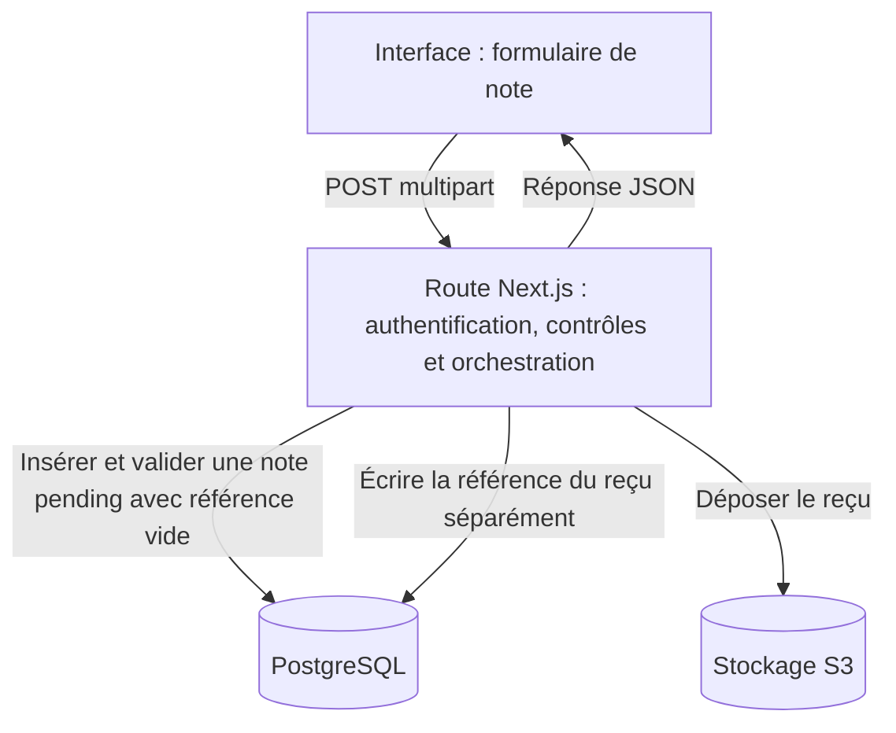
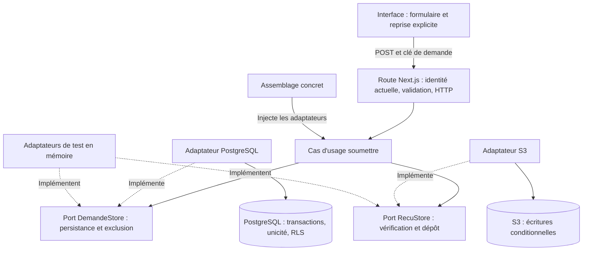

# Architecture logicielle : avant et après

Lecture de code comparée le 24 octobre 2026. Original : `265924bc7274047989e708ab635c2854d376230f`. Version intégrée : `2e9e30c`. Les schémas montrent les responsabilités et appels dans **un même monolithe Next.js**, pas des microservices. Les résultats de tests sont référencés dans les [fiches AUD](README.md) ; cette comparaison statique n'est pas une nouvelle exécution applicative.

## Acteurs et règles conservés

| Acteur | Ce qu'il consulte ou décide |
| --- | --- |
| Utilisateur authentifié | Ses propres notes, reçus et suggestions OCR ; un manager ou RH peut aussi soumettre une note personnelle |
| Manager | Notes pending de ses collaborateurs directs dans la même entreprise |
| RH | Annuaire de son entreprise, affectations de managers et notes pending des managers racines |

Le domaine email regroupe les utilisateurs dans une entreprise ; il ne donne pas à tous les rôles accès à toutes les notes. Un manager racine n'a pas de manager ; ses notes sont décidées par RH. Le filtre pending concerne les listes de décision ; les reçus déjà décidés restent consultables dans le périmètre autorisé. Les autres règles de portée sont dans la [matrice de référence](02-permissions-et-transitions.md).

## Avant : orchestration dans la route

Dans `src/app/api/expense-notes/route.ts` à la révision originale, la route connaît directement SQL et le stockage. Elle insère et valide d'abord une note `pending`, dépose le fichier dans S3 puis met à jour sa référence dans une autre opération. **Si le dépôt échoue, la note peut déjà être pending sans reçu.** Refaire tout le POST peut créer une nouvelle note. Une transaction SQL seule ne peut pas annuler une écriture S3. C'est le problème de [AUD-003](solutions-to-audit/AUD-003-receipt-consistency.md).

Les dossiers `src/domain`, `src/ports` et `src/adapters` existent déjà, mais la route de soumission ne les utilise pas. Leur présence ne suffit donc pas à produire une inversion des dépendances. L'authentification donne un rôle de session ; plusieurs permissions et politiques DB présentent les écarts détaillés dans les fiches AUD. [Mesure historique des imports](evidence/structure-imports.json).

## Après : module hexagonal limité à la soumission

Un **port** est ici une interface exprimant ce dont le cas d'usage a besoin ; un **adaptateur** est l'implémentation concrète de cette interface. Le cœur dépend de ces contrats, pas de Next.js, de `pg` ou du SDK AWS. Le point d'assemblage choisit les adaptateurs réels. Il ne s'agit pas d'une nouvelle couche réseau.

| Responsabilité actuelle | Fichiers |
| --- | --- |
| Extraire la session, vérifier montant/date/fichier et traduire résultat/erreur en HTTP | `src/app/api/expense-notes/route.ts`, `src/utils/validators.ts` |
| Orchestrer création, reprise et conservation d'une décision | `src/modules/soumission/soumettre.ts` |
| Définir les types et les opérations métier utiles | `src/modules/soumission/ports.ts`, `empreinte.ts` |
| Réserver une demande, exclure deux exécutions actives et finaliser sous contexte utilisateur | `src/modules/soumission/adaptateurs/postgres.ts`, `src/lib/db.ts`, migrations |
| Lire et vérifier le reçu ; écrire sous condition de version | `src/modules/soumission/adaptateurs/s3.ts`, `src/lib/storage.ts` |
| Injecter les dépendances concrètes | `src/modules/soumission/assemblage.ts` |
| Éprouver le même cas d'usage sans HTTP ou infrastructure, puis compléter en réel | `tests/support/soumission-memoire.ts`, tests unitaires/API/navigateur |

### Flux actuel d'une soumission

1. L'interface conserve une clé de demande pour reprendre le même envoi. Une nouvelle clé représente une autre dépense, même si son contenu est identique. Le client historique sans clé reste accepté.
2. La route relit le rôle et l'entreprise actuels, valide les champs et les octets du fichier, puis appelle `soumettre`.
3. L'adaptateur DB exclut les exécutions simultanées de la même demande. Il retrouve ou crée **une note incomplete**, avec unicité par acteur et clé ; les transactions restent courtes. La connexion portant le verrou reste réservée pendant le traitement, sans transaction SQL ouverte pendant S3.
4. Le module vérifie le reçu ou le dépose. Les conditions de version S3 évitent qu'un ancien écrivain écrase un objet entre-temps. Un reçu déjà conforme est réutilisé.
5. Référence du reçu et transition vers `pending` sont enregistrées ensemble. Une panne laisse une note récupérable ; un réessai retrouve cette note. Une décision existante n'est jamais remise à pending. Le montant initial avant arrondi est conservé pour reprendre après perte du stockage navigateur.
6. La route rend le résultat au format public conservé ; l'interface actualise la liste ou présente la reprise et le message d'erreur.

### Autres protections intégrées

- **Identité et permissions :** rôle/entreprise relus en base pour les requêtes protégées ; filtres API et RLS se complètent. La protection RLS reste inactive avec le superutilisateur de l'environnement local fourni : elle est éprouvée sous compte limité dans le harnais, pas activée par ce document.
- **Décisions et hiérarchie :** état pending vérifié dans l'UPDATE ; décisions et affectations prennent le verrou de l'entreprise dans le même ordre. Les relations sont relues après l'attente et les cycles sont refusés. Les routes manager et RH restent séparées.
- **OCR :** bouton indépendant de la soumission, moteur local Tesseract réutilisé, capacité par défaut 1, aucune file. Occupé : 503 ; traitement dépassé : arrêt du thread puis 504. Le dépôt accepte les PDF ; l'OCR reste limité aux images PNG/JPEG/WebP.
- **Inscription :** création de l'entreprise et du premier RH dans la même transaction ; connexion après commit. Le seed répare ses notes et reçus sans effacer les décisions.
- **Erreurs et interface :** erreur publique compréhensible, diagnostic technique interne sans secret, indicateurs libérés après échec ; commandes et apparence conservées.

## Pourquoi cette architecture

Le flux DB/S3 contient les pannes et répétitions qui nécessitent une orchestration explicite. L'extraction permet de tester ces règles par interfaces et de remplacer une dépendance sans réécrire le cas d'usage. Réécrire tout le projet aurait augmenté le périmètre sans preuve de bénéfice. **Les autres routes peuvent encore utiliser SQL directement : le projet entier n'est pas annoncé comme une architecture hexagonale complète.**

Choix et alternatives : [ADR-0002](../adr/0002-hexagonal-soumission.md). Contrats et responsabilités : [passation](03-perimetre-et-dependances.md). Réalisation et limites : [SPEC-09](../specs/SPEC-09-soumission-isolee.md), [AUD-003](solutions-to-audit/AUD-003-receipt-consistency.md#implementation), [AUD-009](solutions-to-audit/AUD-009-database-company-isolation.md#implementation). L'arrêt OCR et les chiffres de performance ont leurs [mesures datées](evidence/ocr-pool-20261019/README.md) ; ce schéma n'en extrapole aucune capacité de production.
