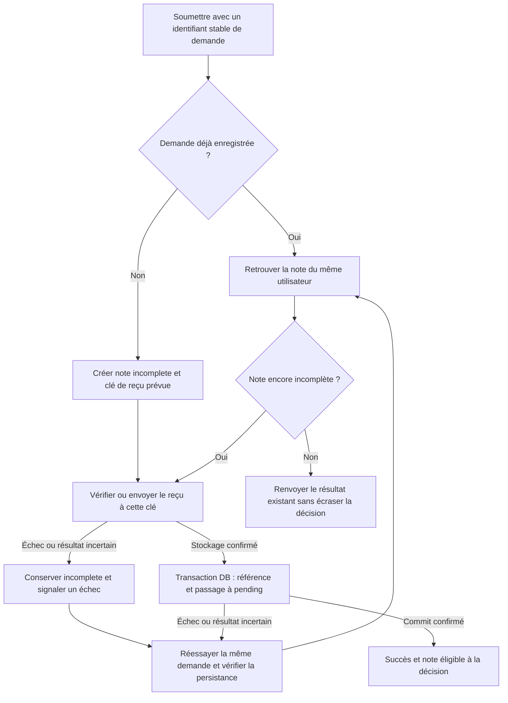

# AUD-003 — Soumission incomplète et récupération du reçu

Direction acceptée le 11 octobre, précisée le 14 octobre 2026 ; non implémentée. Source : `265924bc7274047989e708ab635c2854d376230f`, branche `audit/arla-2026-10`.

## Problème et preuves

OBSERVATION : [route:88–96](../../../src/app/api/expense-notes/route.ts#L88) insère une note avec clé de reçu vide ; [db.ts:38](../../../src/lib/db.ts#L38) valide cette insertion ; [route:101](../../../src/app/api/expense-notes/route.ts#L101) envoie le reçu ; [route:103–110](../../../src/app/api/expense-notes/route.ts#L103) sauvegarde sa référence séparément et traite les erreurs. La [migration:32](../../../migrations/1700000000001_init-schema.sql#L32) définit pending par défaut sans état incomplete. Le formulaire fait un POST de création ([page:74–100](../../../src/app/expenses/page.tsx#L74)).

HYPOTHÈSE : une panne entre ces opérations laisse une note sans reçu exploitable ou un fichier sans référence ; réessayer le POST peut créer un doublon. Aucun scénario de panne ni comportement HTTP mesuré. Une transaction PostgreSQL ne peut pas annuler un upload S3.

## Workflow retenu

Créer une note incomplete avec la clé complète prévue du reçu, avant l'upload. Après confirmation du stockage, valider référence et passage à pending ensemble dans PostgreSQL. Incomplete signifie soumission inachevée ; pending signifie prête pour décision. Une clé prévue ne prouve pas que le fichier existe ; refuser l'approbation côté serveur tant que la note est incomplète.

En cas de reçu déjà stocké et valide, le réutiliser sans nouvel upload. Après un commit incertain, relire le statut : ne pas supposer un rollback, supprimer le reçu ou écraser approved/rejected. Si le reçu manque, le demandeur le fournit à nouveau. La reprise explicite par l'utilisateur est retenue ; contrat exact et emplacement du contrôle restent à définir sans refonte visuelle.

## Identifiant de demande retenu

Créer l'identifiant avant le premier envoi et le conserver pour les réessais. Une nouvelle dépense reçoit une nouvelle clé, même avec montant/date identiques. Associer durablement utilisateur authentifié, clé et note ; réservation et création atomiques avec unicité DB pour les envois simultanés. Toujours vérifier le propriétaire : la clé n'est pas une permission. Une même clé avec contenu incompatible ne doit pas écraser la demande initiale ; réponse à préciser.

Implications : conservation de tentative côté client, ajout compatible à la requête, association/unicité persistées et migration. Les clients existants sans clé doivent être pris en compte ; ne pas rendre le champ obligatoire sans vérifier les contrats et tests du professeur. Conservation après rechargement, expiration, remplacement du reçu et réessais concurrents restent à spécifier.

## Alternatives et compromis

- Upload avant insertion : note complète dès création, mais panne DB laissant un fichier orphelin, compensation faillible et demande non conservée.
- Transaction DB ouverte pendant l'upload : insert/référence groupés, mais S3 reste externe et la connexion demeure occupée pendant le réseau ; pool DB limité à 20 (`src/lib/db.ts:17`), sans bottleneck mesuré.
- Supprimer la note après échec : moins d'états, mais suppression faillible et demande perdue.
- Dédupliquer par montant/date : risque de fusionner deux dépenses légitimes ; nouvelle clé à chaque réessai ne résout pas la réponse perdue.

Le choix retenu conserve la demande et rend la récupération explicite ; il ajoute état, autorisation de reprise, vérification du stockage et traitement des abandons. Il ne rend pas DB et S3 atomiques.

## Compatibilité et validation

Ne pas altérer les notes et décisions existantes lors de l'ajout de l'état ; anciennes incohérences à investiguer séparément, pas de reclassification globale. Préserver fonctions attendues, contrats API et tests du professeur. UI standard, polices/couleurs/positions conservées, contenu français, identifiants existants compatibles. La gestion explicite d'échec/reprise doit être comparée au périmètre fonctionnel avant implémentation.

Vérifications prévues : succès ; échec upload ; upload réussi et finalisation échouée ; résultat incertain ; refus d'approbation incomplete ; reprise même note ; réponse perdue ; demandes distinctes identiques ; envois concurrents ; mauvaise identité ; clé avec contenu différent ; régression des listes et accès reçus. Migration/retour arrière, nettoyage des abandons et contrat exact restent à préparer. Tests exécutés : 0. [Journal](../DECISION_LOG.md).

## Actualisation des preuves — campagne du 14–15 octobre

Panne contrôlée de stockage reproduite via HTTP : réponse 500 et note pending avec receipt_key vide. La reprise cible, le doublon et la réponse perdue restent non testés. [Rapport et résultats bruts](../mesures-et-preuves.md). Les mentions de non-exécution précédentes décrivent la preuve initiale ; aucune validation de correction n’est acquise.

## IMPLEMENTATION

### 2026-10-19 — SPEC-09, personne D

Statut : implémentée et vérifiée sur le périmètre décrit.
Spec : [SPEC-09](../../specs/SPEC-09-soumission-isolee.md), [ADR-0002](../../adr/0002-hexagonal-soumission.md). Révision de départ : `eaa7fbf` (branche de base locale `base/spec-09` = `main` `7377486` + `feat/spec-01` `f5dc2d6` + `feat/spec-02` `4913b50` + `feat/spec-04` `19bdd4c` + `feat/spec-06` `bb16e63`). Réalisation : `5898c42`, `873f56c`, `1c42784`, tests `e8c1b14` et `036b0d5`, branche `feat/spec-09`.

#### Ce qui a été implémenté

Une demande de soumission est identifiée par une clé UUID (en-tête optionnel `Idempotency-Key`) liée durablement à l'utilisateur et à la note par une contrainte d'unicité. La route `POST /api/expense-notes` ne fait plus que l'authentification, la validation des entrées (fonctions pures de SPEC-04) et la traduction des résultats : elle appelle un module de soumission/reprise qui réserve la note en état `incomplete`, prend une réservation d'exécution à jeton et expiration, vérifie ou envoie le reçu, puis passe la note en `pending` avec une écriture bornée sous l'identité du propriétaire. Une répétition de la même demande retrouve la note : 200 avec l'état actuel (décision comprise) si elle est finalisée, 201 à la première finalisation, 409 si le contenu ou le reçu diffère ou si une exécution est en cours. Une panne d'envoi ou de finalisation laisse la note `incomplete`, récupérable. L'interface affiche « incomplète », exclut ces notes du total et propose « Reprendre » dans le formulaire existant. Un client historique sans clé garde le comportement 201 d'avant.

#### Où

| Fichier et repère du nouveau code | Modification | Rôle dans le parcours |
| --- | --- | --- |
| migrations/1700000000020_expense-notes-soumission-rls.sql | Statut `incomplete`, colonnes `request_key`, `request_fingerprint`, `receipt_sha256`, `receipt_size`, `claim_token`, `claim_expires_at`, unicité `(user_id, request_key)` | Demande stable et réservation d'exécution garanties en base |
| src/modules/soumission/soumettre.ts, `soumettre` (l. 34) et `assurerRecu` (l. 98) | Cas d'usage : réserver, prendre, vérifier/déposer le reçu, finaliser, relire après résultat incertain | Orchestration unique, sans Next, pg ni AWS |
| src/modules/soumission/ports.ts, empreinte.ts | Ports `DemandeStore` et `RecuStore`, résultats et erreurs métier, empreinte canonique du contenu | Contrat entre le module et ses adaptateurs |
| src/modules/soumission/adaptateurs/postgres.ts (`reserver` l. 30, `prendre` l. 75, `finaliser` l. 89, `liberer` l. 102) | Transactions courtes sous `withUserScope`, `INSERT ... ON CONFLICT DO NOTHING`, `UPDATE` conditionnels à l'état et au jeton | Unicité, exclusivité et finalisation bornée en base |
| src/modules/soumission/adaptateurs/s3.ts, src/lib/storage.ts (`readReceipt`, délai de 30 s par appel) | Lecture et comparaison d'un objet par taille et empreinte, dépôt borné | Un objet n'est réutilisé que s'il est conforme |
| src/modules/soumission/assemblage.ts | Point d'assemblage des adaptateurs réels | Injection par paramètres |
| src/app/api/expense-notes/route.ts, POST (l. 92) et GET | Clé facultative, reçu facultatif pour une reprise, traduction des résultats, `requestId` des seules notes incomplètes du propriétaire | Adaptateur HTTP |
| src/app/expenses/page.tsx | Clé de tentative en `sessionStorage` par compte, libellé, bouton « Reprendre », total sans les incomplètes | Reprise dans l'interface existante |
| src/app/api/expense-notes/[id]/receipt-url/route.ts | Une note incomplète n'a pas de reçu confirmé : 404 | Pas d'URL signée vers un objet non vérifié |

#### Nouveau fonctionnement

Employé → formulaire (clé créée ou reprise depuis `sessionStorage`) → `POST /api/expense-notes` avec `Idempotency-Key` → identité actuelle (SPEC-06) et validations d'entrée → `soumettre` : (1) réservation ou relecture de la note, transaction courte ; empreinte du contenu comparée (montant avant arrondi sous forme canonique, date, description, reçu) → 409 si différente ; (2) note déjà finalisée : 200 avec son état actuel, jamais remise à `pending` ; (3) réservation d'exécution par `UPDATE` conditionnel (jeton, expiration de 120 s) : un concurrent reçoit 409 sans envoi ; (4) lecture de l'objet à la clé prévue : conforme → réutilisé, absent ou différent → remplacé par le fichier fourni, sinon 400 « le reçu est requis » ; après un résultat incertain d'écriture, l'objet est relu ; (5) finalisation : `UPDATE` vers `pending` conditionné à l'état `incomplete`, au propriétaire et au jeton ; zéro ligne ou erreur incertaine impose une relecture avant toute conclusion ; (6) 201. Aucune transaction n'est ouverte pendant l'envoi vers S3. Une panne laisse la note `incomplete`, libère la réservation et renvoie 500 « La soumission n'a pas pu être terminée. Veuillez la reprendre. » avec diagnostic interne. Après un arrêt brutal, la réservation expire ; l'objet et l'état sont alors relus avant reprise. L'état `incomplete` est refusé aux décisions par la politique RLS et par les routes (voir [AUD-009](AUD-009-database-company-isolation.md#implementation)).

#### Validation et preuves

| Commande ou scénario | Attendu | Résultat réel et compte | Preuve |
| --- | --- | --- | --- |
| `test:issue` équivalent, issue AUD-003 (suites complètes) | PANNE-001 vert, cas ajoutés verts | AUD-003 : 38/38 réussis. Ajoutés : 16 unitaires (SOUM-001 à 016), 13 HTTP/SQL/S3 (SOUM-100 à 112), 4 contrats d'adaptateurs réels (SOUM-120 à 123), 2 navigateur (NAV-030, 031). PANNE-001 était rouge | `reports/issues.json`, 2026-10-19 |
| `npm run ci:docs` ; `npm run lint` ; `npm run typecheck` ; `npm run build` | exit 0 | exit 0 chacun (234 tests identifiés ; 1 avertissement lint préexistant hors périmètre) | Sortie locale 2026-10-19 |
| `npm run test:unit` | Cas du module verts | exit 0 ; 22/22 réussis (16 ajoutés : SOUM-001 à 016) | `reports/unit.json` |
| `npm run test:api` (complète) | Aucune régression | exit 1 ; 131 réussis, 19 échoués sur 150 (état de référence `base/spec-09` : 102/125) | `reports/issues.json` |
| `npm run test:e2e` (complète) | Aucune régression | exit 1 ; 61 réussis, 1 échoué sur 62 (référence : 59/60) | `reports/issues.json` |
| `npm run test:report` | Bilan agrégé | exit 1 ; 214 réussis, 20 échoués sur 234 (référence : 167/191) | `reports/issues.json` |

#### Écarts et limites

Extraction et correction ne sont pas séparées en commits : l'ancienne orchestration de la route est remplacée par le module, pas déplacée à l'identique. Un client sans `Idempotency-Key` ne bénéficie pas de la déduplication (limite acceptée par le contrat). Durées non éprouvées en charge : réservation de 120 s, délai de 30 s par appel S3. Pas de nettoyage automatique des soumissions abandonnées. La reprise depuis la liste préremplit le montant arrondi lu en base si le `sessionStorage` est perdu : un montant saisi avec plus de deux décimales donnerait alors un 409 de contenu différent. Les notes antérieures restent sans clé. Les tests du professeur ne sont pas fournis.

### 2026-10-20 — SPEC-09 : intégration de `main` et alignement sur SPEC-01 et SPEC-04 (personne D)

Statut : implémentée et vérifiée sur le périmètre décrit.
Spec : [SPEC-09](../../specs/SPEC-09-soumission-isolee.md). Révision de départ : `1746cdb`. `main` fusionné : `5dc5024` (fusion `3804a97`). Réalisation : `bc2bd13` (journal des refus), `ce35e50` (test SOUM-113) ; état mesuré : `5cccc42`.

#### Ce qui a été implémenté

La branche contient désormais la version finale de SPEC-01 à 06 (elle n'avait que les premières versions de SPEC-01, 02 et 04, et ni SPEC-03 ni SPEC-05). Seule adaptation nécessaire : les refus de la route de soumission (400 reçu requis, 409 contenu différent ou demande en cours) sont journalisés par `respondRefusal` de `src/lib/errors.ts` au lieu d'un `console.warn` local ; contrat de réponse inchangé. La route utilisait déjà `parseStrictAmount`, `parseStrictExpenseDate`, `detectReceiptType` et `resolveSortOption` : la règle finale de SPEC-04 (montant positif avant arrondi) ne change pas le comportement attendu, ce que prouve SOUM-113. SPEC-02 (`readErrorMessage`), SPEC-03 (`ocr.ts`) et SPEC-05 (`auth.ts`) n'exigent aucune adaptation : l'inscription n'utilise que `SELECT`, `INSERT` et `ON CONFLICT DO NOTHING`, couverts par les droits de `expense_app`.

#### Où

| Fichier et repère du nouveau code | Modification | Rôle dans le parcours |
| --- | --- | --- |
| src/lib/errors.ts, `respondRefusal` (fin de fichier) | Journal d'un refus attendu et réponse `{ error }` | Même fonction, texte identique, que sur `feat/spec-07` |
| src/app/api/expense-notes/route.ts, `refuser` | Délègue à `respondRefusal` | Journal interne unifié |
| tests/api/soumission.spec.ts, SOUM-113 | Montant 0.001 : 201, stocké 0.00, rejeu avec la même clé en 200 (même écriture ou `0.0010`), valeur distincte avant arrondi (0.002) en 409 | Empreinte sur la valeur validée |
| tests/api/coherence.spec.ts | Union des imports de `main` (`withCapturedDiagnostics`) et de SPEC-09 (`appDb`) | Résolution du conflit de fusion |

#### Nouveau fonctionnement

Inchangé par rapport à l'entrée du 2026-10-19 : route → `soumettre` → adaptateurs PostgreSQL et S3. Seul le chemin de journalisation des refus passe par `respondRefusal`.

#### Validation et preuves

| Commande ou scénario | Attendu | Résultat réel et compte | Preuve |
| --- | --- | --- | --- |
| `npm run lint` ; `npm run typecheck` ; `npm run build` | exit 0 | exit 0 chacun (lint : 1 avertissement préexistant hors périmètre) | Run local 2026-10-20 sur `5cccc42` |
| `npm run test:unit` | tous réussis | 41/41 | `reports/unit.json` |
| `npm run test:api` complète | aucun nouveau rouge | 144/161 ; 17 rouges, tous attendus à ce stade car relevant de SPEC-07 (AFF-001 à 008, 011, 016 à 019), SPEC-08 (DEC-005 à 007) et SPEC-10 (SEED-002), non intégrées dans cette branche | `reports/api.json` |
| `npm run test:e2e` complète | aucune régression | 64/64 | `reports/e2e.json` |
| `npm run test:report` | bilan agrégé | exit 1 (les 17 rouges ci-dessus) ; 249/266 ; statut SPEC-09 « incomplete » : REPRISE-001 à 008 et HEXA-001/002 absents du manifeste `tests/specifications.json` (attendu, non traité) | `reports/specifications.json` |
| `npm run test:issue -- AUD-003` / `AUD-009` | cas verts | AUD-003 39/39 ; AUD-009 13/13 | sorties locales du 2026-10-20 |
| `AUDIT_BASE_SHA=5dc5024… node scripts/ci/documentation.mjs` | préfixes de `main` conservés | exit 0 | sortie locale |
| État de référence après fusion de `main` (`3804a97`) | — | unit 41/41, api 143/160, e2e 64/64 (OCR-003, OCR-004 et INS-006, rouges avant la fusion faute de SPEC-03/05, sont verts) | `reports/` du run |

#### Écarts et limites

Extraction (route vers module) et correction restent dans les mêmes commits de la livraison du 2026-10-19 (`5898c42`, `873f56c`) : défaut d'historique connu, non corrigé car l'historique n'est pas réécrit. Les REPRISE-001 à 008 et HEXA-001/002 attendus par le manifeste correspondent à des cas existants sous d'autres identifiants (SOUM-100 à 111 ; SOUM-015 ; SOUM-120 à 123) ; rien n'est renommé ici, la décision revient à Maia. Autres limites de l'entrée du 2026-10-19 inchangées (durées de réservation de 120 s et de délai S3 de 30 s non éprouvées en charge, pas de nettoyage des soumissions abandonnées). Relecture croisée par une autre personne : non faite.

### 2026-10-22 — SPEC-09, exclusion réelle et reprise du montant original

Statut : implémentée et vérifiée sur le périmètre décrit. Départ : `eabdb41`, main/SPEC-07 intégrée par `56157a0`. Réalisation : correction de branche du 22 octobre avant fusion.

#### Ce qui a été implémenté / où

`DemandeStore.executer`, `adaptateurs/postgres.ts` et `lib/db.ts` : verrou de session PostgreSQL par acteur/demande ; la même connexion sert aux transactions courtes de réservation/finalisation, sans transaction pendant S3. Un ancien traitement vivant ne perd plus son exclusion uniquement parce que 120 secondes passent. Si la connexion disparaît, les écritures S3 conditionnelles de `lib/storage.ts` et `adaptateurs/s3.ts` comparent la version observée : création seulement si absente, réparation seulement sur le même ETag. Le jeton reste requis à la finalisation. Connexion détruite si son déverrouillage ne peut être confirmé.

Migration `0030`, route propriétaire et `expenses/page.tsx` : montant original canonique conservé en `request_amount`, rendu uniquement sur une note propriétaire incomplète comme `requestAmount`. Après disparition du stockage navigateur, « Reprendre » conserve 12.345 ou 0.001, au lieu du montant DB arrondi. Le contrôle HTML accepte cette précision pendant la reprise ; disposition et styles inchangés. Le montant public `amount` reste numérique et arrondi par PostgreSQL.

#### Nouveau fonctionnement

Soumission → verrou de demande → réservation DB courte avec montant initial → vérification/écriture S3 conditionnelle hors transaction → finalisation par jeton → libération du verrou. Reprise après rechargement → clé et montant original lus côté propriétaire → même demande, même note, aucune perte de précision ni décision réinitialisée.

#### Validation et preuves

Lint/types/build réussis, unitaires 42/42 ; nouvelles frontières SOUM-017/124/125 et NAV-032/033, dont S3 et PostgreSQL réels sur services jetables. E2E 66/66. Contrôle SPEC-09 : consulter `reports/SPEC-09.json` de la copie isolée ; les échecs DEC-005…007 et SEED-002 restent attribués aux lots 08/10. Les identifiants futurs du manifeste sont reliés aux cas réels dans `docs/testing/README.md`. Préfixes protégés par `/tmp/arla-spec09-20261022.json`.

#### Écarts et limites

Une connexion du pool reste réservée pendant le traitement, sans transaction ouverte. Le délai client S3 ne prouve pas l'arrêt du serveur ; la sécurité repose sur l'exclusion et les conditions de version, pas sur une comparaison de délais. LocalStack 4.0.3 remplace 3.8.1 dans les fichiers Compose car cette dernière ignore If-Match ; aucun service existant n'est redémarré et aucune commande README n'est changée. Les anciennes affirmations fondées sur 120 s contre 30 s sont corrigées par cet ajout, sans réécriture.
