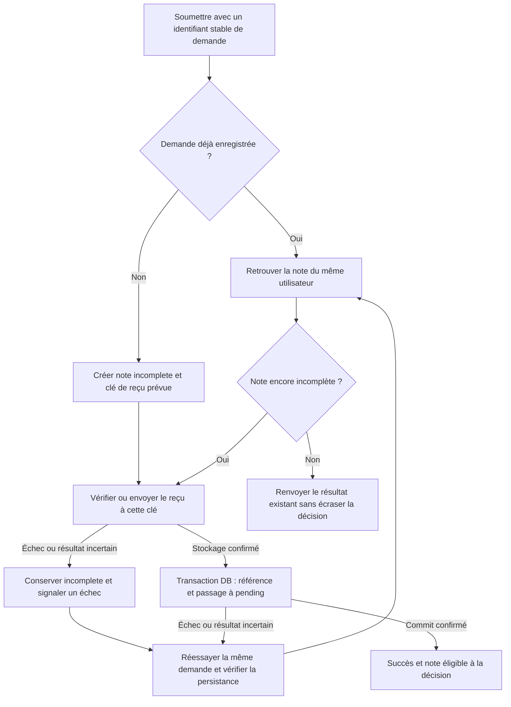

# AUD-003 — Soumission incomplète et récupération du reçu

Direction acceptée le 11 octobre, précisée le 14 octobre 2026 ; non implémentée. Source : `265924bc7274047989e708ab635c2854d376230f`, branche `audit/arla-2026-10`.

## Problème et preuves

OBSERVATION : [route:88–96](../../../src/app/api/expense-notes/route.ts#L88) insère une note avec clé de reçu vide ; [db.ts:38](../../../src/lib/db.ts#L38) valide cette insertion ; [route:101](../../../src/app/api/expense-notes/route.ts#L101) envoie le reçu ; [route:103–110](../../../src/app/api/expense-notes/route.ts#L103) sauvegarde sa référence séparément et traite les erreurs. La [migration:32](../../../migrations/1700000000001_init-schema.sql#L32) définit pending par défaut sans état incomplete. Le formulaire fait un POST de création ([page:74–100](../../../src/app/expenses/page.tsx#L74)).

HYPOTHÈSE : une panne entre ces opérations laisse une note sans reçu exploitable ou un fichier sans référence ; réessayer le POST peut créer un doublon. Aucun scénario de panne ni comportement HTTP mesuré. Une transaction PostgreSQL ne peut pas annuler un upload S3.

## Workflow retenu

Créer une note incomplete avec la clé complète prévue du reçu, avant l'upload. Après confirmation du stockage, valider référence et passage à pending ensemble dans PostgreSQL. Incomplete signifie soumission inachevée ; pending signifie prête pour décision. Une clé prévue ne prouve pas que le fichier existe ; refuser l'approbation côté serveur tant que la note est incomplète.

En cas de reçu déjà stocké et valide, le réutiliser sans nouvel upload. Après un commit incertain, relire le statut : ne pas supposer un rollback, supprimer le reçu ou écraser approved/rejected. Si le reçu manque, le demandeur le fournit à nouveau. La reprise explicite par l'utilisateur est retenue ; contrat exact et emplacement du contrôle restent à définir sans refonte visuelle.

## Identifiant de demande retenu

Créer l'identifiant avant le premier envoi et le conserver pour les réessais. Une nouvelle dépense reçoit une nouvelle clé, même avec montant/date identiques. Associer durablement utilisateur authentifié, clé et note ; réservation et création atomiques avec unicité DB pour les envois simultanés. Toujours vérifier le propriétaire : la clé n'est pas une permission. Une même clé avec contenu incompatible ne doit pas écraser la demande initiale ; réponse à préciser.

Implications : conservation de tentative côté client, ajout compatible à la requête, association/unicité persistées et migration. Les clients existants sans clé doivent être pris en compte ; ne pas rendre le champ obligatoire sans vérifier les contrats et tests du professeur. Conservation après rechargement, expiration, remplacement du reçu et réessais concurrents restent à spécifier.

## Alternatives et compromis

- Upload avant insertion : note complète dès création, mais panne DB laissant un fichier orphelin, compensation faillible et demande non conservée.
- Transaction DB ouverte pendant l'upload : insert/référence groupés, mais S3 reste externe et la connexion demeure occupée pendant le réseau ; pool DB limité à 20 (`src/lib/db.ts:17`), sans bottleneck mesuré.
- Supprimer la note après échec : moins d'états, mais suppression faillible et demande perdue.
- Dédupliquer par montant/date : risque de fusionner deux dépenses légitimes ; nouvelle clé à chaque réessai ne résout pas la réponse perdue.

Le choix retenu conserve la demande et rend la récupération explicite ; il ajoute état, autorisation de reprise, vérification du stockage et traitement des abandons. Il ne rend pas DB et S3 atomiques.

## Compatibilité et validation

Ne pas altérer les notes et décisions existantes lors de l'ajout de l'état ; anciennes incohérences à investiguer séparément, pas de reclassification globale. Préserver fonctions attendues, contrats API et tests du professeur. UI standard, polices/couleurs/positions conservées, contenu français, identifiants existants compatibles. La gestion explicite d'échec/reprise doit être comparée au périmètre fonctionnel avant implémentation.

Vérifications prévues : succès ; échec upload ; upload réussi et finalisation échouée ; résultat incertain ; refus d'approbation incomplete ; reprise même note ; réponse perdue ; demandes distinctes identiques ; envois concurrents ; mauvaise identité ; clé avec contenu différent ; régression des listes et accès reçus. Migration/retour arrière, nettoyage des abandons et contrat exact restent à préparer. Tests exécutés : 0. [Journal](../DECISION_LOG.md).

## Actualisation des preuves — campagne du 14–15 octobre

Panne contrôlée de stockage reproduite via HTTP : réponse 500 et note pending avec receipt_key vide. La reprise cible, le doublon et la réponse perdue restent non testés. [Rapport et résultats bruts](../mesures-et-preuves.md). Les mentions de non-exécution précédentes décrivent la preuve initiale ; aucune validation de correction n’est acquise.
