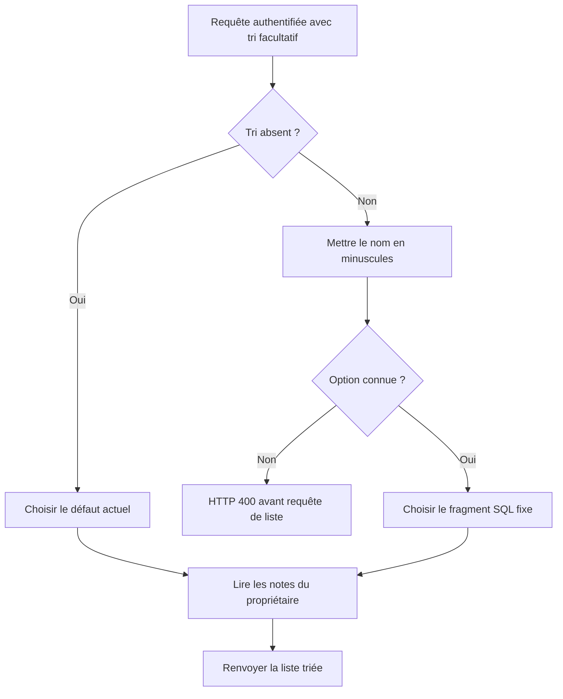

# AUD-004 — Contrôler le tri SQL demandé par le client

Décision acceptée : options nommées insensibles à la casse, valeur inconnue → HTTP 400 avant requête. Non implémenté. Source originale : `265924bc7274047989e708ab635c2854d376230f`.

## Problème, localisation et fonctionnement original

[La liste des notes:42–47](../../../src/app/api/expense-notes/route.ts#L42) lit `sort` dans l'URL puis copie cette chaîne directement après `ORDER BY`. L'identifiant du propriétaire est un paramètre SQL lié, mais le fragment de tri ne l'est pas. Le commentaire aux lignes 39–41 explique qu'un paramètre lié ne remplace pas un nom de colonne ; il ne prouve pas que la concaténation soit sûre.

Par exemple, `?sort=amount DESC` devient une expression de tri dans la requête. Le même chemin peut accueillir d'autres expressions SQL, qui pourraient produire des erreurs ou du travail coûteux. **OBSERVATION :** interpolation de l'entrée client dans la structure SQL. **HYPOTHÈSE :** impact de sécurité ou de disponibilité, à vérifier selon le pilote, les requêtes acceptées et les privilèges. Aucun vol de données ni requête destructrice démontré.

## Pourquoi c'est un problème

Un paramètre SQL lié fournit une valeur, pas une partie de la syntaxe SQL : la chaîne `amount` ne devient pas automatiquement le nom de colonne à trier. Protéger l'identifiant utilisateur ne protège donc pas le fragment de tri indépendant. Le serveur doit autoriser les structures de tri, plutôt que recevoir du SQL choisi par l'appelant.

Le navigateur n'est pas le seul client de l'API. Éviter une mauvaise valeur dans l'UI ne suffit pas ; attendre l'erreur PostgreSQL pourrait laisser entrer l'expression et produire le HTTP 500 générique actuel.

## Fonctionnement retenu

Le serveur traduit une option nommée vers un fragment SQL fixe qu'il possède :

| Option de requête cible | Fragment défini par le serveur |
| --- | --- |
| `newest` | `created_at DESC` |
| `amount_asc` | `amount ASC` |
| `amount_desc` | `amount DESC` |
| Tri absent | `created_at DESC`, défaut actuel conservé |

Mettre le nom reçu en minuscules avant recherche : `AMOUNT_DESC` et `amount_desc` désignent la même option. Une option explicitement inconnue est rejetée en HTTP 400 avant la requête de liste. Le texte reçu sélectionne une entrée ; il n'est jamais inséré comme SQL. Conserver authentification et filtre propriétaire lié.

Ces options sont le contrat cible retenu, pas la preuve d'un ancien contrat documenté. Examiner les consommateurs et valeurs légitimes avant implémentation. `amount DESC` devient `amount desc`, pas `amount_desc` : remplacer une espace par un underscore n'est pas une variation de casse. Cette expression reste refusée selon la cible choisie. Corps d'erreur exact à préparer selon AUD-005.

## Alternatives et compromis

Valider séparément colonne et direction à partir de listes autorisées est possible, mais multiplie les combinaisons pour ce petit ensemble. La table d'options rend les requêtes possibles explicites ; réexaminer si le besoin de tri devient plus riche. Lier toute la chaîne ne la transforme pas en expression de colonne/direction. Un filtrage partiel de ponctuation n'est pas une frontière fiable.

## Validation requise

Inventorier les consommateurs ; vérifier toutes les options en minuscules, majuscules et casse mixte, tri absent, valeur inconnue et entrée ressemblant à du SQL. Vérifier ordre déterministe, dont égalités, défaut conservé, filtre propriétaire et réponse convenue. L'exploitabilité est une investigation distincte. Aucun changement applicatif ni test de correction réalisé dans cette fiche.

## Actualisation des preuves — campagne du 14–15 octobre

Paramètre de tri inexistant : HTTP 500, au lieu du rejet contrôlé 400 retenu. Cela confirme une validation absente, sans démontrer une injection destructive. [Rapport et résultats bruts](../mesures-et-preuves.md). Les mentions de non-exécution précédentes décrivent la preuve initiale ; aucune validation de correction n’est acquise.
