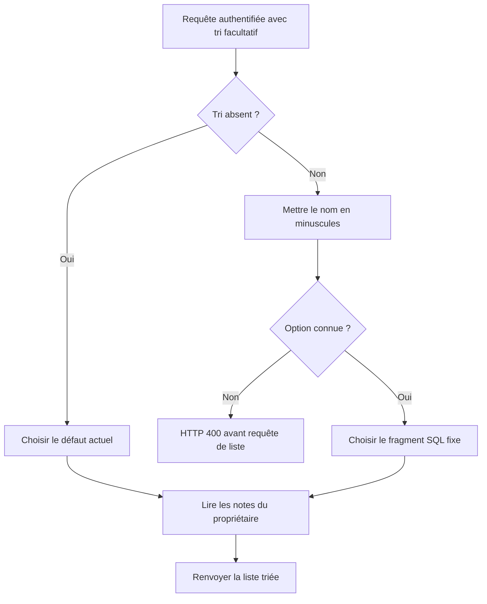

# AUD-004 — Contrôler le tri SQL demandé par le client

Décision acceptée : options nommées insensibles à la casse, valeur inconnue → HTTP 400 avant requête. Non implémenté. Source originale : `265924bc7274047989e708ab635c2854d376230f`.

## Problème, localisation et fonctionnement original

[La liste des notes:42–47](../../../src/app/api/expense-notes/route.ts#L42) lit `sort` dans l'URL puis copie cette chaîne directement après `ORDER BY`. L'identifiant du propriétaire est un paramètre SQL lié, mais le fragment de tri ne l'est pas. Le commentaire aux lignes 39–41 explique qu'un paramètre lié ne remplace pas un nom de colonne ; il ne prouve pas que la concaténation soit sûre.

Par exemple, `?sort=amount DESC` devient une expression de tri dans la requête. Le même chemin peut accueillir d'autres expressions SQL, qui pourraient produire des erreurs ou du travail coûteux. **OBSERVATION :** interpolation de l'entrée client dans la structure SQL. **HYPOTHÈSE :** impact de sécurité ou de disponibilité, à vérifier selon le pilote, les requêtes acceptées et les privilèges. Aucun vol de données ni requête destructrice démontré.

## Pourquoi c'est un problème

Un paramètre SQL lié fournit une valeur, pas une partie de la syntaxe SQL : la chaîne `amount` ne devient pas automatiquement le nom de colonne à trier. Protéger l'identifiant utilisateur ne protège donc pas le fragment de tri indépendant. Le serveur doit autoriser les structures de tri, plutôt que recevoir du SQL choisi par l'appelant.

Le navigateur n'est pas le seul client de l'API. Éviter une mauvaise valeur dans l'UI ne suffit pas ; attendre l'erreur PostgreSQL pourrait laisser entrer l'expression et produire le HTTP 500 générique actuel.

## Fonctionnement retenu

Le serveur traduit une option nommée vers un fragment SQL fixe qu'il possède :

| Option de requête cible | Fragment défini par le serveur |
| --- | --- |
| `newest` | `created_at DESC` |
| `amount_asc` | `amount ASC` |
| `amount_desc` | `amount DESC` |
| Tri absent | `created_at DESC`, défaut actuel conservé |

Mettre le nom reçu en minuscules avant recherche : `AMOUNT_DESC` et `amount_desc` désignent la même option. Une option explicitement inconnue est rejetée en HTTP 400 avant la requête de liste. Le texte reçu sélectionne une entrée ; il n'est jamais inséré comme SQL. Conserver authentification et filtre propriétaire lié.

Ces options sont le contrat cible retenu, pas la preuve d'un ancien contrat documenté. Examiner les consommateurs et valeurs légitimes avant implémentation. `amount DESC` devient `amount desc`, pas `amount_desc` : remplacer une espace par un underscore n'est pas une variation de casse. Cette expression reste refusée selon la cible choisie. Corps d'erreur exact à préparer selon AUD-005.

## Alternatives et compromis

Valider séparément colonne et direction à partir de listes autorisées est possible, mais multiplie les combinaisons pour ce petit ensemble. La table d'options rend les requêtes possibles explicites ; réexaminer si le besoin de tri devient plus riche. Lier toute la chaîne ne la transforme pas en expression de colonne/direction. Un filtrage partiel de ponctuation n'est pas une frontière fiable.

## Validation requise

Inventorier les consommateurs ; vérifier toutes les options en minuscules, majuscules et casse mixte, tri absent, valeur inconnue et entrée ressemblant à du SQL. Vérifier ordre déterministe, dont égalités, défaut conservé, filtre propriétaire et réponse convenue. L'exploitabilité est une investigation distincte. Aucun changement applicatif ni test de correction réalisé dans cette fiche.

## Actualisation des preuves — campagne du 14–15 octobre

Paramètre de tri inexistant : HTTP 500, au lieu du rejet contrôlé 400 retenu. Cela confirme une validation absente, sans démontrer une injection destructive. [Rapport et résultats bruts](../mesures-et-preuves.md). Les mentions de non-exécution précédentes décrivent la preuve initiale ; aucune validation de correction n’est acquise.

## IMPLEMENTATION

### 2026-10-18 — SPEC-04, personne B

Statut : implémentée et vérifiée sur le périmètre décrit.
Spec : [SPEC-04](../../specs/SPEC-04-entrees-et-affichage.md). Révision de départ : `7377486`. Réalisation : `c445659`.

#### Ce qui a été implémenté

`resolveSortOption` (src/utils/validators.ts) traduit le paramètre `sort` (insensible à la casse) vers l'un des trois fragments SQL fixes `newest`/`amount_asc`/`amount_desc`, ou renvoie le défaut `created_at DESC` si absent, ou `null` si inconnu. La route GET refuse `null` en HTTP 400 avant toute requête SQL ; le texte reçu ne traverse plus `ORDER BY`.

#### Où

| Fichier et repère du nouveau code | Modification | Rôle dans le parcours |
| --- | --- | --- |
| src/utils/validators.ts : `SORT_OPTIONS`, `resolveSortOption` | Table d'options nommées fixes | Le serveur choisit le fragment SQL, jamais le client |
| src/app/api/expense-notes/route.ts : `GET` | Appel `resolveSortOption` + 400 si `null` | Refus avant exécution de la requête de liste |

#### Nouveau fonctionnement

Requête GET avec `?sort=...` → `resolveSortOption(raw)` met en minuscules et cherche dans la table fixe → option connue : fragment SQL correspondant (jamais construit depuis le texte reçu) → option absente : défaut `created_at DESC` conservé → option inconnue (y compris une expression SQL comme `created_at DESC, (SELECT 1)`) : HTTP 400 immédiat, aucune requête de liste exécutée → sinon, lecture bornée au propriétaire (`withUserScope`) inchangée.

#### Validation et preuves

| Commande ou scénario | Attendu | Résultat réel et compte | Preuve |
| --- | --- | --- | --- |
| `npm run test:issue -- AUD-004` | LIST-001…006 réussis | 6/6 réussis | `reports/issues.json`, run local 2026-10-18 |
| `npm run test:api` (suite complète) | Aucune régression | 82/112 (AUD-004 0 échec ; 30 échecs restants tous hors périmètre de SPEC-04) | `reports/issues.json` |

Comptes réels : exécution locale macOS, Postgres 16 + LocalStack isolés, aucun service utilisateur arrêté.

#### Écarts et limites

Seules les trois options demandées sont exposées ; un besoin de tri plus riche nécessiterait de réexaminer la table fixe, conformément à l'alternative écartée dans la fiche. Exploitabilité de l'ancienne concaténation non caractérisée davantage (hors périmètre).

### 2026-10-19 — SPEC-04, correction après revue (personne B)

Statut : implémentée et vérifiée sur le périmètre décrit.
Spec : [SPEC-04](../../specs/SPEC-04-entrees-et-affichage.md). Révision de départ : `feat/spec-04` actualisée avec `main` `651b067`. Réalisation : commit de cette entrée sur `feat/spec-04`.

#### Ce qui a été implémenté

La [revue du 19 octobre](../revue-pr-g4bi2004-20261019.md) relève (P2, C1) que la table d'options était un objet littéral : `sort=constructor` ou `sort=__proto__` atteignaient des propriétés héritées et renvoyaient une fonction ou un objet au lieu d'un refus, la route pouvant alors construire un fragment SQL invalide (500) au lieu de 400 avant SQL. La table est désormais une `Map` : seules les trois clés déclarées existent, toute autre valeur donne `null` puis HTTP 400 avant la requête.

#### Où

| Fichier et repère du nouveau code | Modification | Rôle dans le parcours |
| --- | --- | --- |
| src/utils/validators.ts : `SORT_OPTIONS`, `resolveSortOption` | Objet littéral remplacé par une `Map` | Aucune propriété héritée ne devient une option |

#### Validation et preuves

| Commande ou scénario | Attendu | Résultat réel et compte | Preuve |
| --- | --- | --- | --- |
| `npm run test:api` (suite complète) | LIST-001…006 et ENTREE-002 réussis | Tous réussis (`constructor`, `__proto__` → 400) | `reports/api.json` |
| Vérification directe du module | Propriétés héritées refusées | `constructor`, `__proto__`, `toString`, `hasOwnProperty` → `null` ; options nommées inchangées | Sortie locale 2026-10-19 |
| `npm run test:spec:report -- SPEC-04` | Contrôle par spec vert | `passed`, 44/44 | `reports/SPEC-04.json` |

### 29 octobre 2026 — Corrections immédiates de faible risque

Statut : implémentée, validation distante en cours. Autorisation : demande de Maia de rendre la CI interne fusionnable puis de préserver les parcours externes critiques. Base : `08a4e12aa697d6e880f6a9305399a5c5dc2c775b` ; réalisation : diff isolé du 29 octobre 2026. Spec : [SPEC-04, complément](../../specs/SPEC-04-entrees-et-affichage.md).

#### Ce qui a été implémenté et où

Les alias historiques exacts amount ASC et amount DESC sont ajoutés à la Map, insensibles à la casse. Aucun texte SQL reçu n’est interpolé ; l’expression libre de LIST-006 reste refusée. LIST-003/004 vérifient anciennes et nouvelles conventions. Fichiers : src/utils/validators.ts et tests/api/expenses.spec.ts pour le tri ; src/app/api/expense-notes/route.ts et NOTE-006 pour le message de montant.

#### Nouveau fonctionnement

Entrée → validation serveur existante → option fixe ou refus avant SQL → réponse publique compatible. Aucun droit, transaction ou effet persistant supplémentaire.

#### Validation et limites

Les 81 unitaires du code combiné réussissent localement. Lint/types et les suites HTTP/E2E complètes sont relancés sur le diff courant. Les résultats distants seront consignés au SHA exécuté ; aucune assertion de référence n’est retirée.
