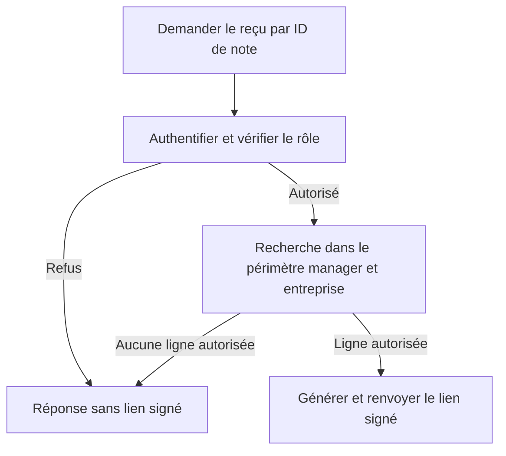

# AUD-006 — Périmètre des reçus et des affectations manager

Deux frontières sous le même ID historique. Directions acceptées, non implémentées. Source originale : `265924bc7274047989e708ab635c2854d376230f`.

## 1. Reçu : localisation et fonctionnement original

- [Route reçu:9](../../../src/app/api/manager/expense-notes/[id]/receipt-url/route.ts#L9) : vérifie la session et le rôle manager.
- [Route reçu:17](../../../src/app/api/manager/expense-notes/[id]/receipt-url/route.ts#L17) : recherche la clé du reçu par l'ID de note fourni, sans condition de rattachement au manager ni d'entreprise ; utilise `getPool`, pas `withUserScope`.
- [Route reçu:23](../../../src/app/api/manager/expense-notes/[id]/receipt-url/route.ts#L23) : génère une URL signée si une ligne est trouvée.
- [Liste manager:27–31](../../../src/app/api/manager/expense-notes/route.ts#L27) : filtre les notes `pending` des employés rattachés au manager courant. Ce filtre appartient à cette liste, pas à la requête de reçu séparée.

## Pourquoi c'est un problème

L'UI montre une liste autorisée, mais un appel direct peut demander un autre ID connu. Vérifier « est-ce un manager ? » ne répond pas à « peut-il consulter cette note ? ». Une URL signée donne accès au fichier : le périmètre doit être établi avant sa création.

**OBSERVATION :** conditions de relation/entreprise absentes de la requête de reçu. **HYPOTHÈSE :** accès hors périmètre possible selon les privilèges PostgreSQL et la RLS effectifs. Aucun accès interdit ni exploit exécuté dans la preuve initiale.

## Fonctionnement retenu pour les reçus

Un manager ne doit pas accéder au reçu d'un employé rattaché à un autre manager, même dans sa propre entreprise. Garder l'ID de note dans l'URL ; prendre l'identité du demandeur dans la session authentifiée. Une requête SQL rejoint le propriétaire et exige le rattachement au manager courant ainsi que le périmètre d'entreprise. Générer le lien uniquement pour une ligne autorisée.

Cette approche réunit recherche et filtrage d'autorisation, suit le motif de la liste et évite de lire une clé non autorisée avant un contrôle séparé. SQL précis, éventuelle restriction aux notes `pending` et réponse de refus restent à spécifier : aucune permission supplémentaire ne découle de cette fiche.

Le contrôle protège la demande de lien, pas toutes les modifications de relation ultérieures. Un lien déjà émis peut fonctionner jusqu'à son expiration ; ne pas promettre une révocation immédiate.

## Alternatives pour les reçus

| Option | Bénéfice / limite et motif |
| --- | --- |
| Lire note/propriétaire puis vérifier en application | Utile pour des règles complexes partagées, mais ajoute ici un chemin de contrôle et sépare recherche/autorisation. Non retenu comme approche principale ; réexaminer si les règles évoluent. |
| RLS seule | Peut protéger plusieurs consommateurs si correctement configurée. Privilèges/contexte non validés et route actuellement hors `withUserScope` : conserver RLS en complément, pas comme seule preuve. |
| ID manager fourni par le navigateur | Substituable par l'appelant ; la session doit fournir l'identité. |
| Liste UI filtrée seule | Contournable par appel direct ; ne protège pas la route de reçu. |

## 2. Affectation : localisation et fonctionnement original

[Route RH:23–25](../../../src/app/api/hr/users/[id]/manager/route.ts#L23) limite l'utilisateur cible à l'entreprise RH. Les [lignes 39–41](../../../src/app/api/hr/users/[id]/manager/route.ts#L39) vérifient le rôle du manager choisi mais pas son entreprise ; les lignes 48–51 sauvegardent cet ID. [Schéma:18](../../../migrations/1700000000001_init-schema.sql#L18) référence un utilisateur existant sans garantir l'égalité d'entreprise.

Pourquoi c'est un problème : une relation interentreprises est incohérente avec la règle retenue. C'est un risque d'intégrité appuyé sur le source, pas une affectation invalide reproduite. Corriger la recherche du reçu ne corrige pas cette écriture. Les politiques AUD-009 concernent `expense_notes`, alors que l'affectation écrit `users.manager_id` ; elles ne rejettent pas à elles seules une relation invalide.

## Fonctionnement retenu pour les affectations

Deux protections complémentaires : recherche API exigeant même entreprise que cible/demandeur, tout en conservant rôle manager et contrôles RH/cible ; contrainte d'intégrité DB assurant une relation même entreprise quel que soit le chemin d'écriture. Garder `null` pour les managers racines légitimes. SQL et migration à préparer après inspection des anciennes relations.

La RLS décide quelles lignes un acteur peut lire/modifier ; une contrainte d'intégrité décide quelles relations peuvent exister. L'autorisation par rôle reste encore un contrôle distinct. Le client ne peut retirer une condition d'entreprise du SQL serveur ; la contrainte protège aussi contre un autre endpoint, seed/import ou SQL direct qui omettrait cette condition.

Pourquoi : refus maîtrisé dans l'API et invariant dans la DB. API seule écartée parce que chaque autre écrivain devrait refaire le contrôle ; RLS des notes seule insuffisante pour cette relation. Complexité de contrainte/migration et compatibilité des données sont les compromis. AUD-010 reste le secret reporté, distinct de l'isolation AUD-009.

## Validation requise

Données isolées : reçu d'employé rattaché, reçu hors rattachement dans la même entreprise, reçu d'une autre entreprise ; anonyme et mauvais rôle ; accès légitimes positifs ; privilèges et RLS réels. Un refus ne doit pas délivrer de lien signé.

Affectation : même entreprise acceptée, interentreprises refusée via HTTP et SQL direct, `null` légitime préservé, données existantes et changements concurrents de manager/entreprise. Aucun résultat runtime ni test de correction acquis par la seule sélection de ces directions.

## Actualisation des preuves — campagne du 14–15 octobre

Manager de A : reçus non rattaché et interentreprises renvoient 200 ; affectation de manager B à employé A acceptée 200. Configuration Docker originale reconstituée avec compte superuser ; privilèges utilisateur réels non inspectés. [Rapport et résultats bruts](../mesures-et-preuves.md). Les mentions de non-exécution précédentes décrivent la preuve initiale ; aucune validation de correction n’est acquise.

## IMPLEMENTATION

### 2026-10-19 — SPEC-06 : volet reçu manager (personne C)

Statut : partielle. Le volet « 1. Reçu » est implémenté ; la validation des suites complètes est rapportée dans une entrée suivante. Le volet « 2. Affectation » n'est pas traité ici : il relève de SPEC-07.
Spec : [SPEC-06](../../specs/SPEC-06-droits-actuels.md). Révision de départ : `7377486`. Réalisation : `6a8b971` (correction) et `c1af070` (tests), branche `feat/spec-06`.

#### Ce qui a été implémenté

La route de reçu manager joint le propriétaire de la note et exige qu'il soit un collaborateur direct du manager actuel et de la même entreprise avant de générer l'URL signée. Aucun filtre d'état n'est ajouté : un reçu déjà approuvé ou rejeté d'un collaborateur direct reste lisible. Hors périmètre ou note absente : 404 sans URL. Les listes pending du manager et les sélections de ses routes approve/reject ajoutent aussi la condition de même entreprise. La logique de décision elle-même (lecture puis écriture) n'est pas modifiée : elle relève de SPEC-08.

#### Où

| Fichier et repère du nouveau code | Modification | Rôle dans le parcours |
| --- | --- | --- |
| src/app/api/manager/expense-notes/[id]/receipt-url/route.ts, requête dans `withUserScope` (l. 17–25) | Remplace la lecture par ID seul (`getPool`) par une jointure `users` avec `manager_id` et `company_id` | Périmètre établi avant l'URL signée |
| src/app/api/manager/expense-notes/route.ts (l. 29, 31) | Condition `u.company_id` ajoutée | Liste limitée à la même entreprise |
| src/app/api/manager/expense-notes/[id]/approve/route.ts et reject/route.ts (l. 17–18) | Condition `u.company_id` ajoutée à la sélection | Une relation manager entre entreprises ne donne plus accès |
| src/lib/current-session.ts | Fournit le rôle et l'entreprise actuels utilisés ci-dessus | Voir [G10](G10-droits-role-actuel.md#implementation) |

#### Nouveau fonctionnement

Manager demande le reçu d'une note → garde de rôle actuel (401 sinon) → une requête sous le contexte du manager cherche la clé de reçu de la note dont le propriétaire a `manager_id` = manager actuel et `company_id` = entreprise actuelle du manager → aucune ligne : 404 sans lien → une ligne : URL signée. Le rattachement et l'entreprise sont lus au moment de la requête : un employé réaffecté ou une entreprise changée modifie l'accès à la requête suivante. Le contrôle protège la demande de lien, pas un lien déjà émis, qui reste valable jusqu'à son expiration.

#### Validation et preuves

| Commande ou scénario | Attendu | Résultat réel et compte | Preuve |
| --- | --- | --- | --- |
| `npm run test:issue -- AUD-006` (DB et S3 jetables du harnais) | Cas de reçu rouges verts ; AFF-011 reste rouge (SPEC-07) | exit 1 ; 31/32 réussis ; seul échec : AFF-011 (volet affectation). DROIT-013 et 014 (origine) verts ; DROIT-024, 029, 030, 032, 033, 036 ajoutés et verts | Sortie locale 2026-10-19, `reports/issues.json` |
| Les nouveaux cas sur le code de `main` (clone jetable) | Les cas `correction` échouent | DROIT-024, 029, 032 : 3 échecs sur 3 ; DROIT-030, 033, 036 réussis (cas `reference`) | Sortie locale 2026-10-19 |
| `npm run lint` ; `npm run typecheck` ; `npm run build` | exit 0 | exit 0 chacun | Sortie locale 2026-10-19 |
| Suites unitaire, api et e2e complètes | Aucune régression | Non exécutées au moment de cette entrée | À ajouter dans une entrée suivante |

#### Écarts et limites

Volet affectation (même entreprise pour le manager choisi, contrainte d'intégrité en base) : non implémenté, AFF-011 rouge attendu jusqu'à SPEC-07. Le comportement de la RLS sous un compte limité n'est pas éprouvé ici (SPEC-09). Les relations interentreprises déjà présentes en base ne sont ni corrigées ni migrées : elles cessent seulement de donner accès.

### 2026-10-19 — SPEC-06 : suites complètes et classement des échecs

Statut : partielle (volet reçu vérifié ; volet affectation à SPEC-07).
Spec : [SPEC-06](../../specs/SPEC-06-droits-actuels.md). Révision exécutée : `a62e6c5`.

#### Validation et preuves

| Commande ou scénario | Attendu | Résultat réel et compte | Preuve |
| --- | --- | --- | --- |
| `npm run test:api` et `npm run test:e2e` (suites complètes), puis `test:report` | Aucune régression ; seul AFF-011 reste rouge pour cette fiche | AUD-006 : 31 réussis, 1 échoué (AFF-011). Bilan global : 123 réussis, 68 échoués sur 191, sans aucun cas vert sur `main` devenu rouge | `reports/issues.json`, 2026-10-19 |

Détail du classement des 68 échecs et de la comparaison avec `main` : voir l'entrée du même jour de [G10](G10-droits-role-actuel.md#implementation). AFF-011 (affectation d'un manager d'une autre entreprise → 409) était rouge sur `main` et reste à réaliser dans SPEC-07.
