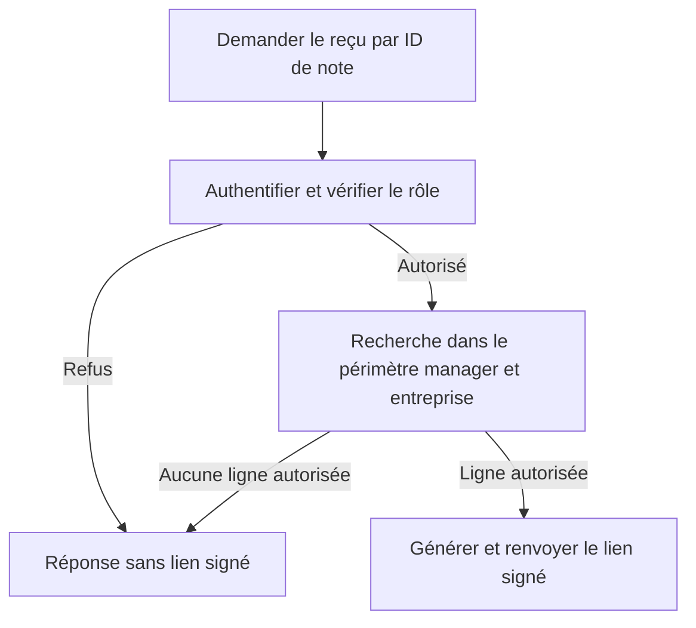

# AUD-006 — Périmètre des reçus et des affectations manager

Deux frontières sous le même ID historique. Directions acceptées, non implémentées. Source originale : `265924bc7274047989e708ab635c2854d376230f`.

## 1. Reçu : localisation et fonctionnement original

- [Route reçu:9](../../../src/app/api/manager/expense-notes/[id]/receipt-url/route.ts#L9) : vérifie la session et le rôle manager.
- [Route reçu:17](../../../src/app/api/manager/expense-notes/[id]/receipt-url/route.ts#L17) : recherche la clé du reçu par l'ID de note fourni, sans condition de rattachement au manager ni d'entreprise ; utilise `getPool`, pas `withUserScope`.
- [Route reçu:23](../../../src/app/api/manager/expense-notes/[id]/receipt-url/route.ts#L23) : génère une URL signée si une ligne est trouvée.
- [Liste manager:27–31](../../../src/app/api/manager/expense-notes/route.ts#L27) : filtre les notes `pending` des employés rattachés au manager courant. Ce filtre appartient à cette liste, pas à la requête de reçu séparée.

## Pourquoi c'est un problème

L'UI montre une liste autorisée, mais un appel direct peut demander un autre ID connu. Vérifier « est-ce un manager ? » ne répond pas à « peut-il consulter cette note ? ». Une URL signée donne accès au fichier : le périmètre doit être établi avant sa création.

**OBSERVATION :** conditions de relation/entreprise absentes de la requête de reçu. **HYPOTHÈSE :** accès hors périmètre possible selon les privilèges PostgreSQL et la RLS effectifs. Aucun accès interdit ni exploit exécuté dans la preuve initiale.

## Fonctionnement retenu pour les reçus

Un manager ne doit pas accéder au reçu d'un employé rattaché à un autre manager, même dans sa propre entreprise. Garder l'ID de note dans l'URL ; prendre l'identité du demandeur dans la session authentifiée. Une requête SQL rejoint le propriétaire et exige le rattachement au manager courant ainsi que le périmètre d'entreprise. Générer le lien uniquement pour une ligne autorisée.

Cette approche réunit recherche et filtrage d'autorisation, suit le motif de la liste et évite de lire une clé non autorisée avant un contrôle séparé. SQL précis, éventuelle restriction aux notes `pending` et réponse de refus restent à spécifier : aucune permission supplémentaire ne découle de cette fiche.

Le contrôle protège la demande de lien, pas toutes les modifications de relation ultérieures. Un lien déjà émis peut fonctionner jusqu'à son expiration ; ne pas promettre une révocation immédiate.

## Alternatives pour les reçus

| Option | Bénéfice / limite et motif |
| --- | --- |
| Lire note/propriétaire puis vérifier en application | Utile pour des règles complexes partagées, mais ajoute ici un chemin de contrôle et sépare recherche/autorisation. Non retenu comme approche principale ; réexaminer si les règles évoluent. |
| RLS seule | Peut protéger plusieurs consommateurs si correctement configurée. Privilèges/contexte non validés et route actuellement hors `withUserScope` : conserver RLS en complément, pas comme seule preuve. |
| ID manager fourni par le navigateur | Substituable par l'appelant ; la session doit fournir l'identité. |
| Liste UI filtrée seule | Contournable par appel direct ; ne protège pas la route de reçu. |

## 2. Affectation : localisation et fonctionnement original

[Route RH:23–25](../../../src/app/api/hr/users/[id]/manager/route.ts#L23) limite l'utilisateur cible à l'entreprise RH. Les [lignes 39–41](../../../src/app/api/hr/users/[id]/manager/route.ts#L39) vérifient le rôle du manager choisi mais pas son entreprise ; les lignes 48–51 sauvegardent cet ID. [Schéma:18](../../../migrations/1700000000001_init-schema.sql#L18) référence un utilisateur existant sans garantir l'égalité d'entreprise.

Pourquoi c'est un problème : une relation interentreprises est incohérente avec la règle retenue. C'est un risque d'intégrité appuyé sur le source, pas une affectation invalide reproduite. Corriger la recherche du reçu ne corrige pas cette écriture. Les politiques AUD-009 concernent `expense_notes`, alors que l'affectation écrit `users.manager_id` ; elles ne rejettent pas à elles seules une relation invalide.

## Fonctionnement retenu pour les affectations

Deux protections complémentaires : recherche API exigeant même entreprise que cible/demandeur, tout en conservant rôle manager et contrôles RH/cible ; contrainte d'intégrité DB assurant une relation même entreprise quel que soit le chemin d'écriture. Garder `null` pour les managers racines légitimes. SQL et migration à préparer après inspection des anciennes relations.

La RLS décide quelles lignes un acteur peut lire/modifier ; une contrainte d'intégrité décide quelles relations peuvent exister. L'autorisation par rôle reste encore un contrôle distinct. Le client ne peut retirer une condition d'entreprise du SQL serveur ; la contrainte protège aussi contre un autre endpoint, seed/import ou SQL direct qui omettrait cette condition.

Pourquoi : refus maîtrisé dans l'API et invariant dans la DB. API seule écartée parce que chaque autre écrivain devrait refaire le contrôle ; RLS des notes seule insuffisante pour cette relation. Complexité de contrainte/migration et compatibilité des données sont les compromis. AUD-010 reste le secret reporté, distinct de l'isolation AUD-009.

## Validation requise

Données isolées : reçu d'employé rattaché, reçu hors rattachement dans la même entreprise, reçu d'une autre entreprise ; anonyme et mauvais rôle ; accès légitimes positifs ; privilèges et RLS réels. Un refus ne doit pas délivrer de lien signé.

Affectation : même entreprise acceptée, interentreprises refusée via HTTP et SQL direct, `null` légitime préservé, données existantes et changements concurrents de manager/entreprise. Aucun résultat runtime ni test de correction acquis par la seule sélection de ces directions.

## Actualisation des preuves — campagne du 14–15 octobre

Manager de A : reçus non rattaché et interentreprises renvoient 200 ; affectation de manager B à employé A acceptée 200. Configuration Docker originale reconstituée avec compte superuser ; privilèges utilisateur réels non inspectés. [Rapport et résultats bruts](../mesures-et-preuves.md). Les mentions de non-exécution précédentes décrivent la preuve initiale ; aucune validation de correction n’est acquise.
