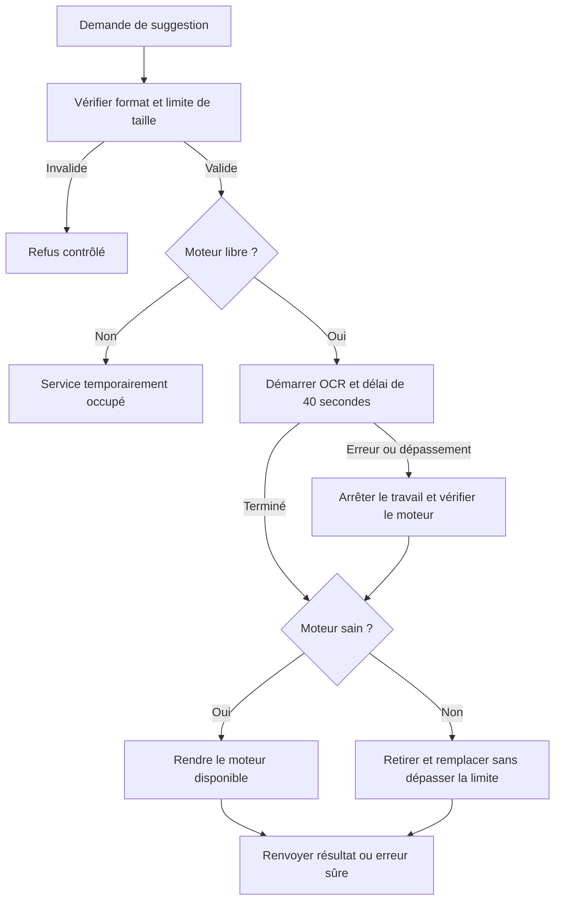

# AUD-008 — Ressources et durée du traitement OCR

Pool accepté le 13 octobre, saturation/timeout précisés le 14 octobre 2026 ; non implémenté. Source : `265924bc7274047989e708ab635c2854d376230f`.

## Problème et preuves

OBSERVATION : [suggestion:12–19](../../../src/app/api/expense-notes/receipt-suggestion/route.ts#L12) lit le fichier en mémoire sans limite de taille dédiée ; [ocr.ts:118–128](../../../src/lib/ocr.ts#L118) crée et termine un moteur par appel. La borne 10 MiB de la [création:9,84–85](../../../src/app/api/expense-notes/route.ts#L9) ne protège pas cette autre route. Coût CPU/RAM, capacité et latence restent non mesurés ; aucune indisponibilité reproduite.

## Solution retenue

Pool borné de moteurs réutilisables, sans file FIFO ni file durable. Si aucun moteur n'est libre, refuser temporairement avec « Service temporairement occupé, veuillez réessayer ». Un moteur sain rejoint le pool après succès/échec ; retirer/remplacer un moteur cassé sans dépasser la capacité. Prévoir recyclage, arrêt et reprise du processus.

Le traitement OCR est limité à 40 secondes depuis son démarrage. Arrêter réellement le travail au dépassement avant de récupérer/remplacer le moteur ; un délai sur la réponse qui laisse le moteur actif ne suffit pas. 40 secondes est un choix, pas une mesure. Code HTTP/message exact du timeout et mécanisme d'arrêt à définir.

Taille maximale, capacité et ingestion à mesurer avant implémentation : formData peut allouer de la mémoire avant le contrôle de route. Un pool borne un processus, pas automatiquement tous les serveurs. Les documents de Tesseract installés (README ligne 45 et workers_vs_schedulers) décrivent réutilisation/recréation ; cela ne mesure pas un gain dans ce projet.

## Distinguer résultat vide et échec — solution retenue

Localisation initiale au SHA source : [ocr.ts:131–132](../../../src/lib/ocr.ts#L131) journalise une panne moteur puis retourne {}, comme [ocr.ts:113–114](../../../src/lib/ocr.ts#L113) pour un format non pris en charge. [La route:19–20](../../../src/app/api/expense-notes/receipt-suggestion/route.ts#L19) renvoie alors une réponse réussie ; [page.tsx:125–137](../../../src/app/expenses/page.tsx#L125) interprète le vide comme absence de champs reconnus. Pourquoi c'est un problème : l'utilisateur reçoit une explication d'analyse sans résultat alors qu'aucune analyse réussie n'a eu lieu. Construction observée, panne moteur/HTTP non reproduite.

Décision à la demande explicite de proposition acceptée : une analyse réussie sans champs reconnus reste HTTP 200 avec résultat vide ; une panne OCR, une saturation ou un dépassement des 40 secondes ne doivent pas se transformer en succès vide. Retourner une erreur HTTP adaptée avec un message sûr dans le champ string error compatible avec les consommateurs. Diagnostic et code technique dans les logs internes, sans secrets ni stack publique, selon AUD-005. Statuts/messages exacts à préparer ; aucune nouvelle convention API imposée.

L'UI utilise son emplacement d'erreur standard et lit le message contrôlé avec un fallback compréhensible. Saturation : message « Service temporairement occupé, veuillez réessayer » déjà retenu. Les champs saisis restent conservés. Succès vide : invitation actuelle à saisir les champs manuellement. Aucune modification des polices, couleurs ou positions. Le traitement d'un format non pris en charge doit rester cohérent avec le périmètre formel OCR, distinct des formats de pièces jointes ; aucune extension PDF OCR sélectionnée.

Pourquoi : ne pas faire croire qu'un reçu a été analysé lorsque le moteur n'a pas pu travailler. Alternative laisser catch renvoyer {} écartée. Vérifier séparément succès avec champs, succès sans champs, exception moteur, pool plein, arrêt à 40 s et affichage de chaque message. Anciennes réponses à caractériser pour les tests du professeur ; non implémenté, pas de tests de correction.

## Formats et alternatives

Respecter uniquement les formats formellement acceptés, sans élargissement. Le code présent traite PNG/JPEG/WebP (`src/lib/ocr.ts:4,113–114`) ; cette liste n'est pas une preuve des exigences du professeur. Si la source formelle n'est pas fournie, la vérifier avant toute modification de périmètre. Le dépôt accepte séparément les pièces jointes PDF (`src/app/api/expense-notes/route.ts:8`) ; ni suppression des PDF joints ni OCR PDF ajouté.

FIFO envisagée puis écartée pour complexité : attente en mémoire, capacité et annulation supplémentaires. Un compteur seul limite les démarrages mais conserve la création par appel. Une file durable ajoute persistance, états, retries et récupération des résultats, non justifiés actuellement. Le pool limite les traitements actifs avec un coût de mémoire résidente et de lifecycle.

## Validation prévue

Mesurer images fixes petites/grandes, froid/chaud et concurrence, avec durées et ressources. Tester taille/ingestion, saturation, succès, erreur, arrêt réel à 40 s, libération/remplacement, recyclage et arrêt/restart. Conserver saisie manuelle et dépôt légitime des reçus. Tests et mesures exécutés : 0. [Journal](../DECISION_LOG.md).

## Actualisation des preuves — campagne du 14–15 octobre

Trois appels OCR réels ; image corrompue renvoyée 200 avec résultat vide. Gros fichiers, saturation, CPU/RAM et arrêt 40 s non mesurés ; aucun gain du pool encore vérifié. [Rapport et résultats bruts](../mesures-et-preuves.md). Les mentions de non-exécution précédentes décrivent la preuve initiale ; aucune validation de correction n’est acquise.
