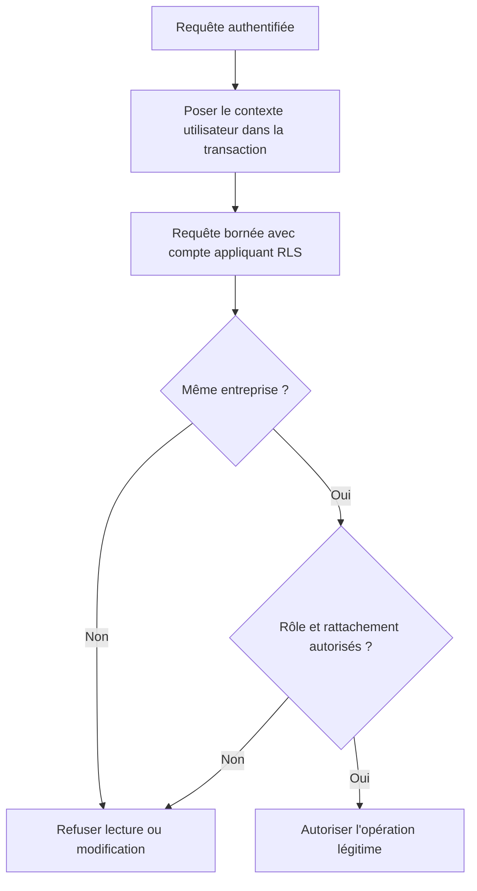

# AUD-009 — Isolation effective entre entreprises dans la base

Direction acceptée : RLS tenant compte de l'entreprise, périmètres des routes conservés et compte applicatif appliquant les politiques. Finalisation bornée de la soumission également acceptée. Non implémenté. Source originale : `265924bc7274047989e708ab635c2854d376230f`.

## Problème, localisation et fonctionnement original

RLS signifie contrôle d'accès aux **lignes** de la base, selon des politiques configurées. Ce n'est pas automatiquement une isolation par entreprise ni un contrôle de chaque colonne modifiée.

- [Migration:39–40](../../../migrations/1700000000001_init-schema.sql#L39) : RLS activée et forcée pour `expense_notes`.
- [Politiques RH:70–100](../../../migrations/1700000000001_init-schema.sql#L70) : propriétaire manager racine et demandeur RH requis ; aucune condition reliant leurs entreprises.
- [db.ts:36](../../../src/lib/db.ts#L36) : `withUserScope` pose `app.current_user_id` à partir de l'identité passée, dans la transaction.
- [Liste RH:30](../../../src/app/api/hr/expense-notes/route.ts#L30) : ajoute séparément le filtre d'entreprise dans sa requête.

## Pourquoi c'est un problème

Scénario de raisonnement : RH-A appartient à l'entreprise A ; Manager-B est manager racine de B et possède Note-B. Une requête sous identité RH-A cherche Note-B sans filtre d'entreprise. Les deux conditions de la politique RH sont satisfaites : propriétaire manager racine et demandeur RH. L'égalité d'entreprise n'est pas vérifiée.

**OBSERVATION :** la politique ne rejette pas cette différence d'entreprise. **HYPOTHÈSE :** lecture/modification effectivement autorisée selon le compte DB, le contexte et toutes les politiques applicables. Aucun accès interentreprises exécuté dans la preuve initiale. La route de liste RH garde son propre filtre : ce raisonnement ne démontre pas qu'elle divulgue Note-B via HTTP. Le risque concerne une requête qui oublierait le filtre et la protection DB attendue.

Activer RLS ne prouve pas qu'un compte privilégié l'applique. Un compte qui la contourne peut aussi masquer un défaut de droit légitime à la finalisation de soumission, détaillé plus bas.

## Fonctionnement retenu et justification

Exiger que demandeur et propriétaire aient la même entreprise, tout en gardant rôles/rattachements autorisés. Examiner l'ensemble des politiques applicables : une autre politique permissive ne doit pas rouvrir l'accès refusé par celle corrigée. SQL et migration exacts à préparer.

L'identité vient de l'authentification serveur via `withUserScope`, l'entreprise de données DB fiables, pas d'un champ fourni par le navigateur. Garder les filtres des routes. Vérifier les privilèges du compte réel ; s'il contourne RLS, préparer une correction de configuration avec privilèges limités avant d'affirmer que les politiques protègent les données. Ne pas remplacer silencieusement ce compte par un compte de test et appeler cela une validation du déploiement fourni.

Pourquoi : les règles DB complètent les contrôles de chaque API et protègent les requêtes qui oublieraient leur filtre. Le projet utilise déjà PostgreSQL, sans service supplémentaire. Compromis : complexité des politiques/privilèges, migration et risque de refuser un accès légitime si les conditions sont incorrectes.



Ce graphe décrit la règle retenue, pas l'ordre réel d'évaluation du SQL ni un résultat de test.

## Alternatives non retenues

| Alternative | Motif |
| --- | --- |
| Filtres d'entreprise uniquement dans les routes | Un autre chemin peut oublier la condition ; garder les filtres comme protection complémentaire. |
| Conserver les politiques puisque RLS est activée | L'activation ne corrige ni la condition d'entreprise absente ni les privilèges qui contournent les politiques. |
| Base séparée par entreprise | Ajoute préparation, migrations et exploitation sans exigence démontrée de séparation physique ; réexaminer si le besoin apparaît. |

Le chantier ne démontre pas l'isolation de toutes les tables/consommateurs. Aucun schéma, compte ou code applicatif modifié dans cette fiche.

## Validation et complément de finalisation

### Complément — finalisation de la soumission

RLS est le contrôle d'accès aux lignes de la base. Le problème est de préserver le droit légitime de terminer une soumission quand ce contrôle est réellement appliqué.

| Localisation initiale au SHA source | Fonctionnement initial | Pourquoi cela pose un problème |
| --- | --- | --- |
| [Route de création:88–96](../../../src/app/api/expense-notes/route.ts#L88) | Insère la note dans withUserScope avec l'identité de la session | L'identité est disponible seulement pendant cette opération transactionnelle |
| [db.ts:35–38](../../../src/lib/db.ts#L35) | BEGIN, set_config avec portée locale à la transaction, callback puis COMMIT | Le contexte utilisateur n'est pas conservé pour une requête ultérieure hors transaction |
| [Route de création:103–106](../../../src/app/api/expense-notes/route.ts#L103) | Sauvegarde receipt_key via getPool, par ID seul, sans withUserScope | La finalisation ne pose plus explicitement l'identité pour l'autorisation DB, ni le propriétaire dans son prédicat |
| [Migration:42–100](../../../migrations/1700000000001_init-schema.sql#L42) | Politiques propriétaire SELECT/INSERT ; UPDATE défini pour manager et RH, sans propriétaire UPDATE dédié | Une soumission autorisée à l'insertion peut ne pas être autorisée à sauvegarder sa référence reçue |

```text
Création de la note : identité utilisateur fournie à la base.
Fin de cette transaction : ce contexte local cesse.
Upload du reçu : opération externe S3.
Mise à jour de la note : identité non posée pour cette nouvelle opération.
Si RLS est appliqué : risque de refus ou de zéro ligne modifiée.
```

OBSERVATION : ces appels et politiques sont présents dans le source. HYPOTHÈSE : la finalisation échoue sous un compte appliquant RLS. Privilèges/configuration réels inconnus ; aucun échec DB mesuré. Un compte qui contourne RLS peut masquer ce problème tout en annulant la protection attendue.

DIRECTION complémentaire acceptée le 14 octobre 2026, non implémentée :

1. Après vérification de l'upload, ouvrir une nouvelle transaction withUserScope sur l'identité authentifiée, pour toute la finalisation DB. Ne pas garder une transaction ouverte pendant S3.
2. Employer un UPDATE serveur limité à la note de ce propriétaire et à l'état de soumission autorisé, modifiant uniquement référence reçue et état de complétion selon AUD-003. Vérifier le résultat de l'écriture ; zéro ligne n'est pas un succès.
3. Définir des permissions/politiques DB permettant cette finalisation bornée tout en conservant entreprise et propriété. Ne pas ajouter un droit UPDATE propriétaire général : l'utilisateur ne doit ni approuver sa note, ni réattribuer son propriétaire, ni modifier librement une note déjà décidée. Les colonnes, transitions et privilèges effectifs doivent être vérifiés ensemble ; RLS contrôle des lignes, pas à elle seule toutes les mutations de colonnes.
4. Avec le compte réel et un compte appliquant RLS pour isoler la logique, tester succès de sa soumission, refus sur une autre note/entreprise, refus d'auto-approbation et reprise après panne. Ne pas substituer un compte de test à la preuve de la configuration réelle.

Pourquoi : conserver une seule identité fiable et le même contrôle d'accès pour chaque écriture légitime, sans désactiver RLS. Alternatives : conserver getPool sans contexte reste fragile ; contourner RLS masque le défaut ; UPDATE propriétaire général élargit excessivement les droits. Mécanisme SQL précis, permissions et migration à préparer avant implémentation. Aucun compte DB, schéma ou donnée changé.

## Protocole de validation requis

Créer uniquement des fixtures isolées A/B, avec utilisateurs, rôles et notes valides connus. Sous identité A, chercher directement une note B par ID **sans** filtre d'entreprise pour observer la politique, avec le compte réellement configuré. Inspecter privilèges, propriété des tables, éventuel `BYPASSRLS`/superutilisateur et contexte. Vérifier séparément les routes HTTP : elles ajoutent des contrôles différents.

Un compte complémentaire appliquant RLS peut isoler sa logique, mais ne remplace pas la preuve du compte applicatif réel. Examiner lecture, écriture et combinaison des politiques, sous plusieurs rôles.

Contrôles positifs indispensables : employé A lit sa note A, manager A lit celle d'un collaborateur autorisé, RH-A lit celle d'un manager racine autorisé dans A. Puis vérifier refus de B pour ces rôles. Les succès légitimes et IDs existants empêchent une politique refusant tout ou une fixture absente de ressembler à une isolation réussie.

`users.company_id` est `NOT NULL` dans le schéma:13 ; un utilisateur valide ne peut simplement avoir aucune entreprise. Accès anonyme HTTP et contexte DB utilisateur absent sont deux tests distincts, qui ne remplacent pas un utilisateur A valide tentant B.

Tester aussi finalisation de sa note, refus sur une autre note/entreprise, auto-approbation interdite, reprise après panne et résultat de l'UPDATE réellement vérifié. Enregistrer configuration, commandes, réponses et états. Aucun résultat runtime ni test de correction acquis par la seule sélection de cette direction. [Journal](../DECISION_LOG.md), [registre](../issues.md).

## Actualisation des preuves — campagne du 14–15 octobre

Configuration Docker reconstituée : compte superuser/BYPASSRLS. Sous rôle de test limité distinct : RH-A lit note de manager racine B ; finalisation sans contexte modifie zéro ligne. Aucun changement des services utilisateur ; politiques corrigées non testées. [Rapport et résultats bruts](../mesures-et-preuves.md). Les mentions de non-exécution précédentes décrivent la preuve initiale ; aucune validation de correction n’est acquise.

## IMPLEMENTATION

### 2026-10-19 — SPEC-09, personne D

Statut : implémentée et vérifiée sur le périmètre décrit (compte applicatif du harnais CI) ; la configuration d'un compte limité pour un déploiement existant reste à faire par l'exploitant.
Spec : [SPEC-09](../../specs/SPEC-09-soumission-isolee.md), [ADR-0002](../../adr/0002-hexagonal-soumission.md). Révision de départ : `eaa7fbf` (voir [AUD-003](AUD-003-receipt-consistency.md#implementation)). Réalisation : `5898c42`, tests `e8c1b14` et `036b0d5`, branche `feat/spec-09`.

#### Ce qui a été implémenté

Les politiques RLS de `expense_notes` sont recréées, une par action, avec la même entreprise, le rôle actuel et la relation pour le manager et le RH, sans politique permissive parallèle. Le propriétaire ne peut créer qu'une soumission `incomplete` à son nom et ne peut finaliser que sa propre note incomplète vers `pending` ; il ne peut ni l'approuver, ni changer le montant, la date, la description ou le propriétaire, ni supprimer. Manager et RH ne décident qu'une note `pending` de leur périmètre, vers `approved` ou `rejected`, jamais une note incomplète. Un rôle de groupe `expense_app` (ni superutilisateur ni BYPASSRLS) reçoit des privilèges de colonne limités à `receipt_key`, `status` et aux colonnes de réservation. Le harnais CI utilise désormais ce compte pour le serveur et distingue le compte de préparation (migrations, fixtures, seed). La finalisation de la soumission passe par `withUserScope` sous l'identité du propriétaire, dans une transaction distincte de l'envoi S3.

#### Où

| Fichier et repère du nouveau code | Modification | Rôle dans le parcours |
| --- | --- | --- |
| migrations/1700000000020_expense-notes-soumission-rls.sql, politiques (l. 34–120) | `expense_notes_owner_insert`, `owner_finalize`, `manager_select`/`update`, `hr_root_manager_select`/`update` recréées avec entreprise, rôle actuel, état et `WITH CHECK` | Isolation et transitions bornées en base |
| même migration, rôle `expense_app` et `GRANT` (l. 140–155) | Rôle de groupe NOLOGIN, privilèges de colonne, `UPDATE (name)` sur `companies` pour le verrou `FOR UPDATE` de SPEC-07 | Compte applicatif sans droit sur les colonnes protégées |
| scripts/ci/run.mjs, scripts/ci/prepare-app-role.mjs | Crée `ci_app_login` (membre de `expense_app`) et lance le serveur avec lui ; `DATABASE_URL` reste le compte de préparation | Preuve sur le vrai processus applicatif |
| tests/support/database.ts (`appDb`), environment.ts, failure-server.ts | Connexion de test au compte applicatif, instances de panne sous ce compte | Les assertions de protection ne s'exécutent plus avec un superuser |
| .env.example | Documente le compte applicatif limité et le compte de préparation | Configuration d'un déploiement |

#### Nouveau fonctionnement

Requête applicative → `withUserScope` pose `app.current_user_id` pour la durée de la transaction (aucun contexte hérité d'une requête précédente dans le pool) → PostgreSQL applique les politiques avec le compte limité : lecture et écriture seulement dans le périmètre rôle/entreprise/relation → les privilèges de colonne interdisent toute modification des colonnes protégées, quel que soit le SQL. Le compte propriétaire des tables (préparation) contourne la RLS ; il sert aux migrations, fixtures et au seed, jamais au serveur. En développement, tant que `DATABASE_URL` pointe un superutilisateur (compte `expense` de `docker-compose.yml`), la RLS n'est pas appliquée : c'est inchangé et documenté dans `.env.example`.

#### Validation et preuves

| Commande ou scénario | Attendu | Résultat réel et compte | Preuve |
| --- | --- | --- | --- |
| Suites complètes, issue AUD-009 | RLS-001, 002, 005 verts, cas ajoutés verts | AUD-009 : 13/13 réussis (RLS-001, 002, 005 étaient rouges ; RLS-006 à 013 ajoutés : privilèges de colonne, finalisation propriétaire, création, autre propriétaire, manager/RH, relation interentreprises, contexte, politiques) | `reports/issues.json`, 2026-10-19 |
| `npm run ci:docs` ; `npm run lint` ; `npm run typecheck` ; `npm run build` | exit 0 | exit 0 chacun (234 tests identifiés ; 1 avertissement lint préexistant hors périmètre) | Sortie locale 2026-10-19 |
| `npm run test:unit` | Cas du module verts | exit 0 ; 22/22 réussis (16 ajoutés : SOUM-001 à 016) | `reports/unit.json` |
| `npm run test:api` (complète) | Aucune régression | exit 1 ; 131 réussis, 19 échoués sur 150 (état de référence `base/spec-09` : 102/125) | `reports/issues.json` |
| `npm run test:e2e` (complète) | Aucune régression | exit 1 ; 61 réussis, 1 échoué sur 62 (référence : 59/60) | `reports/issues.json` |
| `npm run test:report` | Bilan agrégé | exit 1 ; 214 réussis, 20 échoués sur 234 (référence : 167/191) | `reports/issues.json` |

#### Écarts et limites

Le compte du déploiement fourni (`docker-compose.yml`) reste un superutilisateur : le basculement vers `expense_app` doit être configuré par l'exploitant, il n'est pas imposé aux commandes README. Le droit de passer une note de `incomplete` à `pending` ne vérifie pas l'existence du reçu côté base : cette vérification est dans le module (S3). La contrainte `status IN (...)` et les politiques ne couvrent que `expense_notes` ; `users` n'a pas de RLS. Les décisions concurrentes manager/RH (SPEC-08) ne sont pas encore atomiques : DEC-005 à 007 restent rouges, comme avant.

### 2026-10-20 — SPEC-09 : intégration de `main`, limites du compte applicatif (personne D)

Statut : implémentée et vérifiée sur le périmètre décrit (compte applicatif du harnais CI) ; configuration d'un compte limité en déploiement à la charge de l'exploitant.
Spec : [SPEC-09](../../specs/SPEC-09-soumission-isolee.md). Révision de départ : `1746cdb`. `main` fusionné : `5dc5024`. Réalisation : aucun changement de politique ni de droit ; état mesuré : `5cccc42`.

#### Ce qui a été implémenté

Aucune modification de la migration `1700000000020` ni des politiques. Le contrôle a été refait sur le code de `main` fusionné : les routes de SPEC-03, 04, 05 et 06 fonctionnent sous `expense_app` (le serveur de test tourne avec `ci_app_login`), RLS-001 et RLS-006 à 013 restent verts.

#### Où

| Fichier et repère du nouveau code | Modification | Rôle dans le parcours |
| --- | --- | --- |
| migrations/1700000000020_expense-notes-soumission-rls.sql | inchangé | Politiques, rôle `expense_app`, droits de colonne |

#### Nouveau fonctionnement

Inchangé : voir l'entrée du 2026-10-19.

#### Validation et preuves

| Commande ou scénario | Attendu | Résultat réel et compte | Preuve |
| --- | --- | --- | --- |
| `npm run lint` ; `npm run typecheck` ; `npm run build` | exit 0 | exit 0 chacun (lint : 1 avertissement préexistant hors périmètre) | Run local 2026-10-20 sur `5cccc42` |
| `npm run test:unit` | tous réussis | 41/41 | `reports/unit.json` |
| `npm run test:api` complète | aucun nouveau rouge | 144/161 ; 17 rouges, tous attendus à ce stade car relevant de SPEC-07 (AFF-001 à 008, 011, 016 à 019), SPEC-08 (DEC-005 à 007) et SPEC-10 (SEED-002), non intégrées dans cette branche | `reports/api.json` |
| `npm run test:e2e` complète | aucune régression | 64/64 | `reports/e2e.json` |
| `npm run test:report` | bilan agrégé | exit 1 (les 17 rouges ci-dessus) ; 249/266 ; statut SPEC-09 « incomplete » : REPRISE-001 à 008 et HEXA-001/002 absents du manifeste `tests/specifications.json` (attendu, non traité) | `reports/specifications.json` |
| `npm run test:issue -- AUD-003` / `AUD-009` | cas verts | AUD-003 39/39 ; AUD-009 13/13 | sorties locales du 2026-10-20 |
| `AUDIT_BASE_SHA=5dc5024… node scripts/ci/documentation.mjs` | préfixes de `main` conservés | exit 0 | sortie locale |
| État de référence après fusion de `main` (`3804a97`) | — | unit 41/41, api 143/160, e2e 64/64 (OCR-003, OCR-004 et INS-006, rouges avant la fusion faute de SPEC-03/05, sont verts) | `reports/` du run |

#### Écarts et limites

**Décision D2 (critère C7).** `docker-compose.yml` n'est pas modifié : le compte fourni (`expense`) reste superutilisateur et PostgreSQL n'y applique pas la RLS. La preuve d'un compte non superuser et sans `BYPASSRLS` est apportée par le harnais CI (RLS-001 et RLS-006 à 013 sous `ci_app_login`) et par la documentation de `.env.example` ; l'application réelle n'est protégée que si l'exploitant utilise un rôle membre de `expense_app` comme `DATABASE_URL`. Les commandes README sont conservées.
Droits de colonne : `UPDATE (receipt_key, status, claim_token, claim_expires_at)` est accordé au rôle, pas à une politique ; une requête SQL émise sous l'identité d'un manager ou du RH pour une note de son périmètre en `pending` pourrait donc aussi modifier `receipt_key` (analyse de la migration, non exécutée ; les routes de l'application ne le font pas). À soumettre à la relecture croisée de C. Une ancienne limite de l'entrée du 2026-10-19 (« décisions manager/RH non atomiques ») est levée par la branche `feat/spec-08`, pas par celle-ci. Ordre des migrations : `0020` ne doit pas être appliquée avant `0010` (SPEC-07) sur une base partagée : node-pg-migrate refuse sinon `0010` sans `--no-check-order` (vérifié sur une base jetable). Relecture croisée de chaque politique et de chaque `GRANT` par une autre personne : non faite.

### 2026-10-22 — SPEC-09, opérations SQL de reçu bornées

Statut : implémentée et vérifiée sous le compte applicatif limité du harnais. Départ : `eabdb41`, intégration `56157a0` ; correction de branche du 22 octobre.

#### Ce qui a été implémenté / où

Migration `1700000000030_reprise-montant-et-integrite-recu.sql` : INSERT applicatif limité aux colonnes utiles (compteur de reçu exclu), clé initiale vide obligatoire ; le déclencheur autorise uniquement l'attribution initiale de la clé dérivée de ce compteur. Une décision manager/RH ne peut changer simultanément statut et reçu, ni toucher une réservation. Le compte de préparation superuser est explicitement exempté pour les fixtures, migrations et réparations du seed. Le montant original est stocké sans privilège UPDATE applicatif.

#### Nouveau fonctionnement

Compte applicatif + identité serveur → RLS vérifie rôle/entreprise/relation → privilèges de colonnes et déclencheur bornent l'écriture → aucun rattachement d'un reçu étranger par INSERT ni UPDATE ; décisions légitimes conservées. La soumission garde la même note et finalise sans droit UPDATE général sur montant ou propriétaire.

#### Validation et preuves

RLS-014 : substitutions de reçu et de jeton refusées avec 42501, décision normale permise. RLS-015 : clé étrangère et compteur injecté refusés, réservation vide autorisée. PostgreSQL réel sous `ci_app_login`, sans superuser/BYPASSRLS ; tests API complets et E2E exécutés en copie isolée. Résultats et contrôles SPEC-09 dans `reports/` ; snapshot `/tmp/arla-spec09-20261022.json`.

#### Écarts et limites

Le compte DB des services utilisateur n'a pas été modifié : comme indiqué précédemment, RLS effective exige que l'exploitant utilise un compte membre de expense_app sans superuser/BYPASSRLS. La preuve du harnais ne vaut pas une configuration de production validée. Les textes antérieurs et leurs limites sont conservés.
