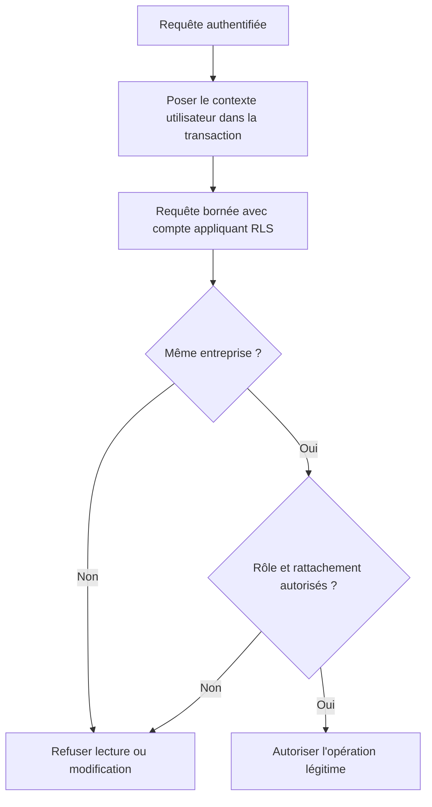

# AUD-009 — Isolation effective entre entreprises dans la base

Direction acceptée : RLS tenant compte de l'entreprise, périmètres des routes conservés et compte applicatif appliquant les politiques. Finalisation bornée de la soumission également acceptée. Non implémenté. Source originale : `265924bc7274047989e708ab635c2854d376230f`.

## Problème, localisation et fonctionnement original

RLS signifie contrôle d'accès aux **lignes** de la base, selon des politiques configurées. Ce n'est pas automatiquement une isolation par entreprise ni un contrôle de chaque colonne modifiée.

- [Migration:39–40](../../../migrations/1700000000001_init-schema.sql#L39) : RLS activée et forcée pour `expense_notes`.
- [Politiques RH:70–100](../../../migrations/1700000000001_init-schema.sql#L70) : propriétaire manager racine et demandeur RH requis ; aucune condition reliant leurs entreprises.
- [db.ts:36](../../../src/lib/db.ts#L36) : `withUserScope` pose `app.current_user_id` à partir de l'identité passée, dans la transaction.
- [Liste RH:30](../../../src/app/api/hr/expense-notes/route.ts#L30) : ajoute séparément le filtre d'entreprise dans sa requête.

## Pourquoi c'est un problème

Scénario de raisonnement : RH-A appartient à l'entreprise A ; Manager-B est manager racine de B et possède Note-B. Une requête sous identité RH-A cherche Note-B sans filtre d'entreprise. Les deux conditions de la politique RH sont satisfaites : propriétaire manager racine et demandeur RH. L'égalité d'entreprise n'est pas vérifiée.

**OBSERVATION :** la politique ne rejette pas cette différence d'entreprise. **HYPOTHÈSE :** lecture/modification effectivement autorisée selon le compte DB, le contexte et toutes les politiques applicables. Aucun accès interentreprises exécuté dans la preuve initiale. La route de liste RH garde son propre filtre : ce raisonnement ne démontre pas qu'elle divulgue Note-B via HTTP. Le risque concerne une requête qui oublierait le filtre et la protection DB attendue.

Activer RLS ne prouve pas qu'un compte privilégié l'applique. Un compte qui la contourne peut aussi masquer un défaut de droit légitime à la finalisation de soumission, détaillé plus bas.

## Fonctionnement retenu et justification

Exiger que demandeur et propriétaire aient la même entreprise, tout en gardant rôles/rattachements autorisés. Examiner l'ensemble des politiques applicables : une autre politique permissive ne doit pas rouvrir l'accès refusé par celle corrigée. SQL et migration exacts à préparer.

L'identité vient de l'authentification serveur via `withUserScope`, l'entreprise de données DB fiables, pas d'un champ fourni par le navigateur. Garder les filtres des routes. Vérifier les privilèges du compte réel ; s'il contourne RLS, préparer une correction de configuration avec privilèges limités avant d'affirmer que les politiques protègent les données. Ne pas remplacer silencieusement ce compte par un compte de test et appeler cela une validation du déploiement fourni.

Pourquoi : les règles DB complètent les contrôles de chaque API et protègent les requêtes qui oublieraient leur filtre. Le projet utilise déjà PostgreSQL, sans service supplémentaire. Compromis : complexité des politiques/privilèges, migration et risque de refuser un accès légitime si les conditions sont incorrectes.



Ce graphe décrit la règle retenue, pas l'ordre réel d'évaluation du SQL ni un résultat de test.

## Alternatives non retenues

| Alternative | Motif |
| --- | --- |
| Filtres d'entreprise uniquement dans les routes | Un autre chemin peut oublier la condition ; garder les filtres comme protection complémentaire. |
| Conserver les politiques puisque RLS est activée | L'activation ne corrige ni la condition d'entreprise absente ni les privilèges qui contournent les politiques. |
| Base séparée par entreprise | Ajoute préparation, migrations et exploitation sans exigence démontrée de séparation physique ; réexaminer si le besoin apparaît. |

Le chantier ne démontre pas l'isolation de toutes les tables/consommateurs. Aucun schéma, compte ou code applicatif modifié dans cette fiche.

## Validation et complément de finalisation

### Complément — finalisation de la soumission

RLS est le contrôle d'accès aux lignes de la base. Le problème est de préserver le droit légitime de terminer une soumission quand ce contrôle est réellement appliqué.

| Localisation initiale au SHA source | Fonctionnement initial | Pourquoi cela pose un problème |
| --- | --- | --- |
| [Route de création:88–96](../../../src/app/api/expense-notes/route.ts#L88) | Insère la note dans withUserScope avec l'identité de la session | L'identité est disponible seulement pendant cette opération transactionnelle |
| [db.ts:35–38](../../../src/lib/db.ts#L35) | BEGIN, set_config avec portée locale à la transaction, callback puis COMMIT | Le contexte utilisateur n'est pas conservé pour une requête ultérieure hors transaction |
| [Route de création:103–106](../../../src/app/api/expense-notes/route.ts#L103) | Sauvegarde receipt_key via getPool, par ID seul, sans withUserScope | La finalisation ne pose plus explicitement l'identité pour l'autorisation DB, ni le propriétaire dans son prédicat |
| [Migration:42–100](../../../migrations/1700000000001_init-schema.sql#L42) | Politiques propriétaire SELECT/INSERT ; UPDATE défini pour manager et RH, sans propriétaire UPDATE dédié | Une soumission autorisée à l'insertion peut ne pas être autorisée à sauvegarder sa référence reçue |

```text
Création de la note : identité utilisateur fournie à la base.
Fin de cette transaction : ce contexte local cesse.
Upload du reçu : opération externe S3.
Mise à jour de la note : identité non posée pour cette nouvelle opération.
Si RLS est appliqué : risque de refus ou de zéro ligne modifiée.
```

OBSERVATION : ces appels et politiques sont présents dans le source. HYPOTHÈSE : la finalisation échoue sous un compte appliquant RLS. Privilèges/configuration réels inconnus ; aucun échec DB mesuré. Un compte qui contourne RLS peut masquer ce problème tout en annulant la protection attendue.

DIRECTION complémentaire acceptée le 14 octobre 2026, non implémentée :

1. Après vérification de l'upload, ouvrir une nouvelle transaction withUserScope sur l'identité authentifiée, pour toute la finalisation DB. Ne pas garder une transaction ouverte pendant S3.
2. Employer un UPDATE serveur limité à la note de ce propriétaire et à l'état de soumission autorisé, modifiant uniquement référence reçue et état de complétion selon AUD-003. Vérifier le résultat de l'écriture ; zéro ligne n'est pas un succès.
3. Définir des permissions/politiques DB permettant cette finalisation bornée tout en conservant entreprise et propriété. Ne pas ajouter un droit UPDATE propriétaire général : l'utilisateur ne doit ni approuver sa note, ni réattribuer son propriétaire, ni modifier librement une note déjà décidée. Les colonnes, transitions et privilèges effectifs doivent être vérifiés ensemble ; RLS contrôle des lignes, pas à elle seule toutes les mutations de colonnes.
4. Avec le compte réel et un compte appliquant RLS pour isoler la logique, tester succès de sa soumission, refus sur une autre note/entreprise, refus d'auto-approbation et reprise après panne. Ne pas substituer un compte de test à la preuve de la configuration réelle.

Pourquoi : conserver une seule identité fiable et le même contrôle d'accès pour chaque écriture légitime, sans désactiver RLS. Alternatives : conserver getPool sans contexte reste fragile ; contourner RLS masque le défaut ; UPDATE propriétaire général élargit excessivement les droits. Mécanisme SQL précis, permissions et migration à préparer avant implémentation. Aucun compte DB, schéma ou donnée changé.

## Protocole de validation requis

Créer uniquement des fixtures isolées A/B, avec utilisateurs, rôles et notes valides connus. Sous identité A, chercher directement une note B par ID **sans** filtre d'entreprise pour observer la politique, avec le compte réellement configuré. Inspecter privilèges, propriété des tables, éventuel `BYPASSRLS`/superutilisateur et contexte. Vérifier séparément les routes HTTP : elles ajoutent des contrôles différents.

Un compte complémentaire appliquant RLS peut isoler sa logique, mais ne remplace pas la preuve du compte applicatif réel. Examiner lecture, écriture et combinaison des politiques, sous plusieurs rôles.

Contrôles positifs indispensables : employé A lit sa note A, manager A lit celle d'un collaborateur autorisé, RH-A lit celle d'un manager racine autorisé dans A. Puis vérifier refus de B pour ces rôles. Les succès légitimes et IDs existants empêchent une politique refusant tout ou une fixture absente de ressembler à une isolation réussie.

`users.company_id` est `NOT NULL` dans le schéma:13 ; un utilisateur valide ne peut simplement avoir aucune entreprise. Accès anonyme HTTP et contexte DB utilisateur absent sont deux tests distincts, qui ne remplacent pas un utilisateur A valide tentant B.

Tester aussi finalisation de sa note, refus sur une autre note/entreprise, auto-approbation interdite, reprise après panne et résultat de l'UPDATE réellement vérifié. Enregistrer configuration, commandes, réponses et états. Aucun résultat runtime ni test de correction acquis par la seule sélection de cette direction. [Journal](../DECISION_LOG.md), [registre](../issues.md).

## Actualisation des preuves — campagne du 14–15 octobre

Configuration Docker reconstituée : compte superuser/BYPASSRLS. Sous rôle de test limité distinct : RH-A lit note de manager racine B ; finalisation sans contexte modifie zéro ligne. Aucun changement des services utilisateur ; politiques corrigées non testées. [Rapport et résultats bruts](../mesures-et-preuves.md). Les mentions de non-exécution précédentes décrivent la preuve initiale ; aucune validation de correction n’est acquise.
