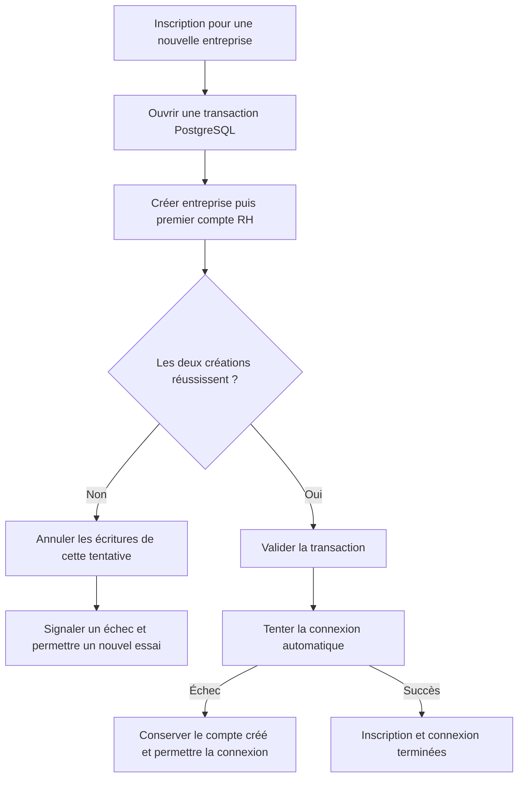

# AUD-013 — Cohérence de l'inscription

Statut : transaction acceptée le 14 octobre 2026, non implémentée. Source : `265924bc7274047989e708ab635c2854d376230f`. [ADR](../../adr/0001-inscription-atomique.md).

## Problème et preuves

OBSERVATION : [auth.ts:44–49](../../../src/app/actions/auth.ts#L44) crée l'entreprise par un appel au pool, puis [auth.ts:65–69](../../../src/app/actions/auth.ts#L65) crée le compte par un autre appel, sans transaction commune. Être dans la même action et utiliser await ordonne les opérations, sans les valider ensemble. La connexion automatique suit à la ligne 72.

HYPOTHÈSE : si le compte échoue après création de l'entreprise, celle-ci reste sans son premier RH ; un réessai prend la branche entreprise existante (lignes 57–62) et attribue employee. Ce scénario n'est pas reproduit : un test de panne contrôlée est requis avant de parler de défaut runtime confirmé.

## Décision actuelle — transaction unique

Sur une seule connexion PostgreSQL, regrouper la création de l'entreprise et de son premier compte RH. Valider les deux ensemble ou annuler les écritures de cette tentative. « Ensemble » signifie atomicité de la validation, pas exécution parallèle. La connexion automatique intervient après commit ; son échec ne supprime pas un compte correctement créé. Préserver l'inscription dans une entreprise existante et ne jamais supprimer celle-ci après un échec.

Pourquoi : les deux écritures utilisent la même base ; rollback natif et moins d'état que reprise durable ou suppression compensatoire. Aucun changement de schéma requis par le seul regroupement transactionnel. Les contrats publics, les rôles attendus et les commandes existantes restent à préserver.

## Alternatives et limites

- Commits indépendants avec reprise : choix précédent, remplacé le 14 octobre. Nécessite état durable, identité autorisée, concurrence et nettoyage ; coût injustifié ici.
- Suppression automatique après échec : peut échouer ou ne pas s'exécuter après un arrêt du processus. Une suppression aveugle risque d'affecter une entreprise existante.
- Conserver le code actuel : plus simple, mais n'apporte aucune annulation groupée.

La transaction ne répare pas automatiquement les anciennes entreprises incomplètes ; les examiner séparément. Une réponse perdue après commit ne signifie pas que les créations ont échoué : vérifier la persistance avant de répéter. Concurrence et branches entreprise existante à caractériser. Reconsidérer si l'inscription implique un système externe ou une reprise durable exigée par le métier.

## Validation prévue

Données isolées : succès sur entreprise fraîche ; échec contrôlé après insertion de l'entreprise et avant création du RH ; absence des créations après rollback ; nouvel essai et rôle attendu ; entreprise existante ; inscriptions simultanées ; connexion automatique échouée après commit. Enregistrer fixtures, SHA, commandes, états et résultats. Tests exécutés : 0. Aucune implémentation ni communication externe.
