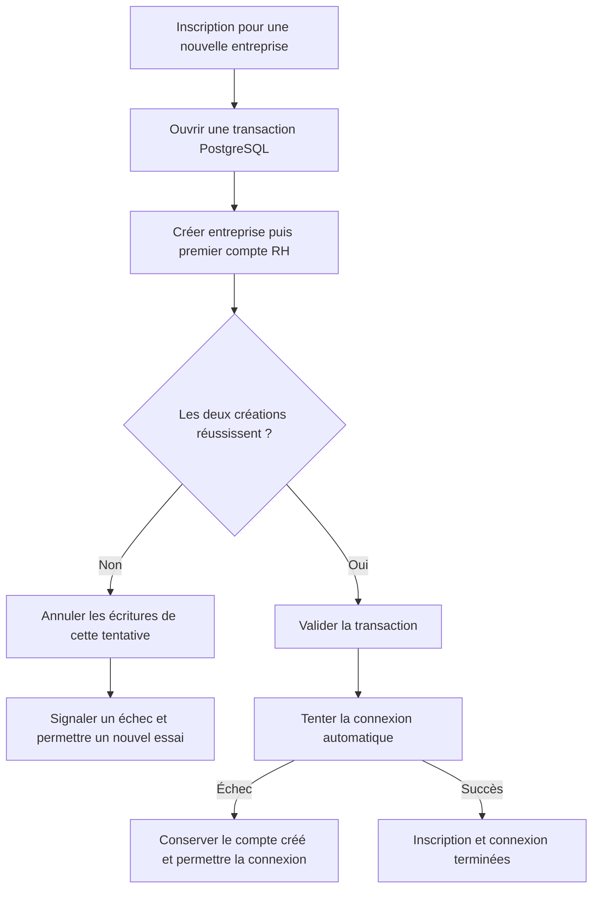

# AUD-013 — Cohérence de l'inscription

Statut : transaction acceptée le 14 octobre 2026, non implémentée. Source : `265924bc7274047989e708ab635c2854d376230f`. [ADR](../../adr/0001-inscription-atomique.md).

## Problème et preuves

OBSERVATION : [auth.ts:44–49](../../../src/app/actions/auth.ts#L44) crée l'entreprise par un appel au pool, puis [auth.ts:65–69](../../../src/app/actions/auth.ts#L65) crée le compte par un autre appel, sans transaction commune. Être dans la même action et utiliser await ordonne les opérations, sans les valider ensemble. La connexion automatique suit à la ligne 72.

HYPOTHÈSE : si le compte échoue après création de l'entreprise, celle-ci reste sans son premier RH ; un réessai prend la branche entreprise existante (lignes 57–62) et attribue employee. Ce scénario n'est pas reproduit : un test de panne contrôlée est requis avant de parler de défaut runtime confirmé.

## Décision actuelle — transaction unique

Sur une seule connexion PostgreSQL, regrouper la création de l'entreprise et de son premier compte RH. Valider les deux ensemble ou annuler les écritures de cette tentative. « Ensemble » signifie atomicité de la validation, pas exécution parallèle. La connexion automatique intervient après commit ; son échec ne supprime pas un compte correctement créé. Préserver l'inscription dans une entreprise existante et ne jamais supprimer celle-ci après un échec.

Pourquoi : les deux écritures utilisent la même base ; rollback natif et moins d'état que reprise durable ou suppression compensatoire. Aucun changement de schéma requis par le seul regroupement transactionnel. Les contrats publics, les rôles attendus et les commandes existantes restent à préserver.

## Alternatives et limites

- Commits indépendants avec reprise : choix précédent, remplacé le 14 octobre. Nécessite état durable, identité autorisée, concurrence et nettoyage ; coût injustifié ici.
- Suppression automatique après échec : peut échouer ou ne pas s'exécuter après un arrêt du processus. Une suppression aveugle risque d'affecter une entreprise existante.
- Conserver le code actuel : plus simple, mais n'apporte aucune annulation groupée.

La transaction ne répare pas automatiquement les anciennes entreprises incomplètes ; les examiner séparément. Une réponse perdue après commit ne signifie pas que les créations ont échoué : vérifier la persistance avant de répéter. Concurrence et branches entreprise existante à caractériser. Reconsidérer si l'inscription implique un système externe ou une reprise durable exigée par le métier.

## Validation prévue

Données isolées : succès sur entreprise fraîche ; échec contrôlé après insertion de l'entreprise et avant création du RH ; absence des créations après rollback ; nouvel essai et rôle attendu ; entreprise existante ; inscriptions simultanées ; connexion automatique échouée après commit. Enregistrer fixtures, SHA, commandes, états et résultats. Tests exécutés : 0. Aucune implémentation ni communication externe.

## IMPLEMENTATION

### 2026-10-18 — SPEC-05, personne B

Statut : implémentée et vérifiée sur le périmètre décrit.
Spec : [SPEC-05](../../specs/SPEC-05-inscription-atomique.md). Révision de départ : `7377486`. Réalisation : `ba39f53`.

#### Ce qui a été implémenté

`signup` (src/app/actions/auth.ts) ouvre une transaction sur une connexion unique (`client = await getPool().connect()`) qui couvre : la vérification d'email déjà pris, la création ou réutilisation de l'entreprise (`INSERT ... ON CONFLICT (email_domain) DO NOTHING RETURNING id` suivi d'un `SELECT` si la ligne existait déjà), puis la création du premier compte. Un échec à n'importe quelle étape après `BEGIN` déclenche un `ROLLBACK` qui annule aussi la création de l'entreprise de cette tentative — elle ne reste donc jamais orpheline. Une entreprise déjà existante avant la tentative n'est jamais réécrite dans la branche "domaine existant", donc un rollback n'a aucun effet sur elle, conformément à la décision retenue. La connexion automatique (`signIn`) reste après le commit, hors transaction : son échec ne supprime pas le compte créé. Une violation d'unicité Postgres (`code 23505`, concurrence sur le même email) est traduite en message existant plutôt que propagée brute.

#### Où

| Fichier et repère du nouveau code | Modification | Rôle dans le parcours |
| --- | --- | --- |
| src/app/actions/auth.ts:12–20 | `UNIQUE_VIOLATION`, `isUniqueViolation` | Distingue une course sur l'email d'une autre panne DB |
| src/app/actions/auth.ts:43–98 | `signup` : transaction unique entreprise + utilisateur | Atomicité entreprise/premier RH (AUD-013) |

#### Nouveau fonctionnement

Soumission du formulaire → validations de forme inchangées (nom/email/mot de passe) → hash du mot de passe (hors transaction, indépendant de l'état DB) → `BEGIN` sur une connexion dédiée → re-vérification de l'email → création ou lecture de l'entreprise par domaine → insertion du premier compte (rôle `hr_admin` si l'entreprise vient d'être créée, `employee` sinon) → `COMMIT` si tout réussit, `ROLLBACK` sinon (entreprise nouvellement créée annulée avec l'utilisateur ; entreprise déjà existante non affectée) → après commit uniquement, tentative de connexion automatique, dont l'échec ne supprime pas le compte. AUD-019 (confiance dans le domaine déclaré) n'est pas modifié : aucune vérification de possession d'adresse n'est ajoutée, conformément à la décision retenue (convention pédagogique conservée, pas un défaut à corriger).

#### Validation et preuves

| Commande ou scénario | Attendu | Résultat réel et compte | Preuve |
| --- | --- | --- | --- |
| `npm run lint` ; `npm run typecheck` ; `npm run build` | exit 0 chacun | exit 0 chacun (1 avertissement lint préexistant hors périmètre) | Sortie locale 2026-10-18 |
| `npm run test:unit` | 6/6 | 6/6 | `reports/unit.json` |
| `npm run test:issue -- AUD-013` | INS-001…007 réussis | 7/7 réussis, y compris INS-006 (panne déclenchée par trigger SQL contrôlé avant insertion de l'utilisateur → 0 entreprise orpheline) | Sortie locale, `reports/issues.json` |
| `npm run test:api` (suite complète) | Aucune régression | 61/112, identique à la mesure de référence sur `main` (AUD-013 n'a pas de cas API) | `reports/issues.json` |
| `npm run test:e2e` (suite complète) | Aucune régression ; AUD-013 entièrement vert | 39/60 ; AUD-013 0 échec ; 21 échecs restants hors périmètre (AUD-016 — SPEC-02 non mergée dans cette branche ; AUD-017 — SPEC-04) | `reports/issues.json` (`byIssue`) |
| Garde append-only | Préfixes strictement conservés | Vérifié : `check-append-only.mjs check --snapshot /tmp/arla-spec-05-gf.json` | Sortie locale 2026-10-18 |

Comptes réels : exécution locale macOS, Postgres 16 + LocalStack isolés sur ports CI dédiés, aucun service utilisateur arrêté. CI GitHub non déclenchée pour cette réalisation locale.

#### Écarts et limites

Branche créée depuis `main` actualisé, sans `feat/spec-02` (AUD-016) ni `feat/spec-01` (AUD-005) encore mergées : les échecs e2e AUD-016 observés sur cette branche sont une dépendance non mergée, pas une régression de ce lot. Aucune vérification de possession du domaine, invitation ou nouveau rôle ajoutée (hors périmètre, AUD-019 reste une limite pédagogique assumée). Coordination avec le compte DB effectif de SPEC-09 non encore faite (SPEC-09 non réalisée à ce jour).
