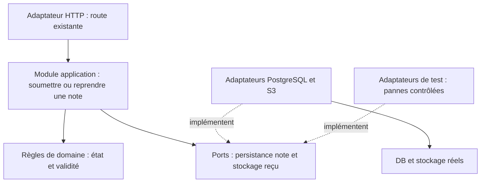

# Revue structurelle et pertinence de l'architecture hexagonale

14 octobre 2026. Source : `265924bc7274047989e708ab635c2854d376230f`. Audit et conception uniquement ; aucun changement applicatif. [Mesures d'import](evidence/structure-imports.json), [architecture existante](architecture.md).

## Recommandation pédagogique et constat

COURSE REQUIREMENT / contexte fourni : les cours mobilisent hexagonal/clean et demandent un audit avec refactorisations justifiées. Une recommandation d'architecture hexagonale des professeurs est maintenant rapportée explicitement ; ne pas la transformer en exigence vérifiée de réécriture complète. ARLA_context cite cours 2 slides 44–48 ; les supports originaux ne sont pas disponibles dans les fichiers locaux inventoriés pour cette passe.

Le principe ports/adapters sépare l'application des technologies qui la déclenchent et des moyens de persistance, pour rendre ses règles testables via une interface stable. Source primaire : [article d'Alistair Cockburn](https://alistair.cockburn.us/hexagonal-architecture). Il ne prescrit ni six modules, ni microservices, ni un port par table.

OBSERVATION : les dossiers actuels amorcent cette organisation, mais elle n'est pas utilisée par les routes. MEASUREMENT : 40 fichiers TS/TSX, 91 imports statiques, 14 fichiers de routes API, dont 12 importent directement lib/db. Aucun import des classes domain ou adaptateurs concrets depuis les routes. Domain n'importe pas d'infrastructure ; les ports de stockage/notification sont consommés seulement par leurs adaptateurs, eux-mêmes sans consommateur applicatif identifié. Ces nombres décrivent les dépendances, pas un gain de maintenabilité déjà mesuré.

## Localisation initiale et conséquences

| Source au SHA audit | Organisation actuelle | Pourquoi examiner cette structure |
| --- | --- | --- |
| `src/app/api/expense-notes/route.ts:56–110` | Une route gère HTTP/session, validation, SQL, S3, finalisation et réponse | Récupération, idempotence et erreurs partielles doivent être testées sans dépendre de Next.js ; vraie orchestration à isoler |
| `src/app/api/manager/expense-notes/[id]/approve/route.ts:13–43`, reject équivalent | Sélection, autorisation, transition, SQL et sérialisation dans la route | La règle et l'atomicité sont difficiles à vérifier séparément ; extraire une classe seule ne corrige pas la concurrence |
| `src/app/api/hr/expense-notes/[id]/approve/route.ts:13–44`, reject équivalent | Même séquence, mais permissions manager racine/entreprise différentes | Partager une règle commune ne doit pas effacer ces différences légitimes |
| `src/domain/ExpenseNote.ts:24–42` | Règles pending-only pures, sans appelant applicatif trouvé | Elles ne protègent pas les mises à jour actuelles et ne suffisent pas à un contrôle concurrent |
| `src/domain/User.ts:3–9,24–29` | Modèle sans entreprise ; canManage examine rôle/rattachement | Ne pas réutiliser ce modèle comme preuve d'isolation entreprise sans le compléter selon les vrais besoins |
| `src/ports/ReceiptStoragePort.ts:1–4`, `src/adapters/S3ReceiptAdapter.ts:4–12` | Interface upload/URL et wrapper autour de lib/storage, non raccordés | Un port réellement utilisé pour upload/vérification du reçu et un adaptateur de test peuvent créer une interface utile |
| `src/ports/NotificationPort.ts:1–3`, `src/adapters/ConsoleNotificationAdapter.ts:3–12` | Notification définie mais non consommée | Ne pas activer de notifications pour démontrer l'architecture : cela ajouterait un comportement |

Ce constat n'est pas « toute route SQL est mauvaise ». Des lectures simples et bornées peuvent rester directes tant qu'une abstraction ne cache pas une complexité réelle. Les défauts de permission, concurrence et persistance restent à corriger explicitement : déplacer les fichiers ne les corrige pas.

## Cible validée : monolithe avec modules hexagonaux utiles

Conserver Next.js, PostgreSQL, S3 compatible et les parcours actuels. Commencer par le module de soumission/récupération d'une note, qui doit coordonner deux persistances et gérer un résultat incertain.

Les flèches pleines vers ports représentent les appels du module ; les pointillés montrent les implémentations. Les adaptateurs concrets sont injectés au point de composition externe ; le module application n'importe ni Next.js, pg, SDK S3, auth ni un adaptateur concret. Le domaine ne connaît pas ces technologies. Les tests du module utilisent la même interface que la route ; les tests DB/S3 réels restent nécessaires.

## Premier périmètre préparé dans la cible validée

- Route actuelle conservée : `src/app/api/expense-notes/route.ts`. Garder méthodes, URL, multipart, JSON, statuts et erreurs selon contrats de référence ; le refactor structurel ne doit pas les modifier silencieusement.
- Module application proposé : `src/application/soumettre-note.ts`. Interface orientée demande/note, pas objets Request/Response ni client pg ; orchestration de validation, identité de demande, reprise et finalisation selon AUD-003.
- Règles dans domain adaptées seulement si nécessaires ; ne pas forcer l'usage de toutes les classes existantes.
- Port de persistance proposé : `src/ports/DepotNotesPort.ts`, opérations métier bornées de réservation/relecture/finalisation. Les transactions, unicité, périmètre propriétaire et état concurrent sont une partie de son contrat ; pas simple CRUD qui reconstitue toutes les règles chez l'appelant.
- Port de reçus existant à utiliser/adapter pour upload et vérification/reprise ; adaptateur S3 actuel raccordé aux capacités nécessaires. La détection de contenu et les bornes restent explicites, pas une promesse que « S3 vérifie tout ».
- Adaptateur PostgreSQL proposé : `src/adapters/DepotNotesPostgres.ts`, SQL scoped et finalisation avec contexte authentifié/permissions RLS bornées. Les opérations atomiques restent SQL, pas une simulation en mémoire considérée comme preuve d'atomicité.
- Tests avec doubles de persistance/stockage pour erreurs partielles ; intégration réelle DB/S3 et tests HTTP/E2E pour confirmer leurs garanties et les contrats.

Noms de fichiers proposés, pas fichiers créés. Contenu français, identifiants/API existants préservés. Pas de container d'injection, nouvelle infrastructure, queue, notifications ou refonte UI. Une simple injection de dépendances suffit.

## Pourquoi cette proposition et alternatives

**Conserver les routes** reste une alternative crédible pour lectures simples. Sur la soumission, les corrections retenues ajoutent orchestration de reprise/idempotence et doubles de panne : une interface stable devient utile. Ceci réexamine la structure à la demande explicite, sans inverser automatiquement le choix précédent de ne pas centraliser les décisions manager/RH.

**Hexagonal ciblé proposé** cache cette orchestration derrière une interface testable et localise les connaissances DB/S3. Coût : types, adaptateurs, composition et tests supplémentaires ; le bénéfice doit apparaître dans l'absence de SQL/S3 dans le cas d'usage et dans des essais de panne clairs, pas dans le nombre de dossiers.

**Réécriture générale immédiate** multiplie les déplacements et le risque avant une baseline fonctionnelle, sans preuve de bénéfice pour tous les modules. Non recommandée. Un repository générique, un port par table ou des services réseau supplémentaires ne sont pas nécessaires.

## Séquence et validation avant migration

1. Définir la référence fonctionnelle, inventorier les contrats des routes concernées et récupérer les attentes/tests du professeur si fournis. Préparer les vérifications isolées sans changer les commandes existantes.
2. Faire expliquer le flux choisi et une frontière de panne avant l'implémentation, selon les instructions de travail. L'accord d'architecture seul n'est pas une preuve de compréhension.
3. Extraire un flux à comportement observé équivalent, dans un changement structurel séparé des corrections et du formatage.
4. Raccorder les corrections déjà acceptées une à une et vérifier contrats, rôles, entreprises, données et états. Les extensions incomplete/reprise exigent toujours la compatibilité explicitement demandée.
5. Étendre ensuite aux décisions et à l'OCR seulement si les responsabilités et tests justifient ces modules ; conserver les règles manager/RH distinctes. Retour arrière structurel sans supprimer de données, migrations d'état évaluées séparément.

Critères : domaine/application sans imports Next/pg/S3 ; module appelé en production et par tests ; adaptateurs réels et doubles à la même interface ; états/pannes vérifiables ; tests de contrats/permissions/atomicité sur vraies dépendances ; UI et commandes inchangées. Ne pas affaiblir les assertions pour faire passer la migration.

## Bilan de cette passe

Décision ultérieure : l'architecture hexagonale est validée explicitement, à condition de rester simple. Cela ne vaut pas implémentation ni clôture des vérifications. Les noms exacts et détails de ports ci-dessus restent de la préparation technique ; aucun framework supplémentaire sélectionné. Le checkpoint de compréhension reste suspendu, pas réputé acquis.

Checkpoint du flux : module de soumission identifié comme responsable de décider que la note est prête. Sur upload S3 réussi/finalisation DB échouée, un succès a été envisagé au motif que DB est dans la couche technique inférieure. Frontière à clarifier : une dépendance technique doit confirmer son opération ; sa position ne permet pas de déclarer un succès métier malgré l'échec. Échec confirmé de finalisation → note reste incomplete, reçu conservé pour reprise ; résultat DB incertain → relire la persistance. Compréhension de cette frontière à vérifier, pas de refactor structurant lancé.

Réponse suivante obtenue : aucune reprise jugée nécessaire dès lors que le reçu est valide. Point restant à expliquer : validité/présence de l'objet S3 et finalisation de la note en PostgreSQL sont deux confirmations distinctes. Réutiliser le reçu valide évite le nouvel upload ; cela ne dispense pas de reprendre la finalisation de la même note restée incomplete. Ne pas considérer la frontière acquise ; clarifier avant toute migration du module.

Fatigue exprimée et nature des questions demandée : les questions suivantes sont interrompues pour cet échange. Il s'agissait d'un checkpoint avant refactor, pas de nouveaux choix de produit. Ne pas déclarer la compréhension acquise, ni continuer le quiz, ni utiliser la fatigue comme accord d'implémentation. Reprendre ultérieurement avec une explication courte et un exercice annoncé explicitement. Conclusion technique à conserver : reçu S3 valide réutilisé, finalisation PostgreSQL reprise, pending seulement après confirmation DB.

Revue d'imports et lecture des responsabilités effectuées ; 0 build, test HTTP, DB, S3 ou E2E exécuté ici. Les 18 exécutions de handlers et 3 observations de fuseau de la passe précédente restent des mesures isolées, pas une baseline complète. Source SHA inchangé ; aucun nouveau défaut runtime déclaré.

Blocages avant changement structurant : baseline réelle absente, contrats exacts à figer, attentes de tests du professeur non inspectées et checkpoint du flux à réaliser. Le secret reste reporté. Statut de cible : accepté, simple et progressif, non implémenté ; [ADR accepté](../adr/0002-hexagonal-soumission.md).
